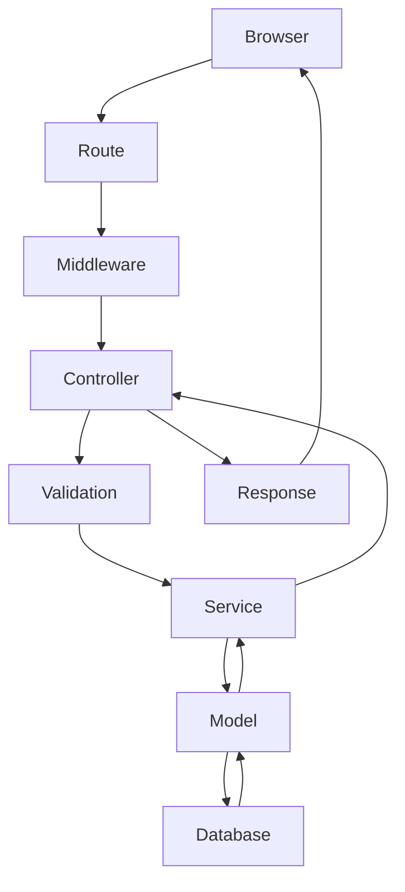

# SCMS - Complete User Guide

## PROJECT OVERVIEW

- **Project Name:** SCMS (School/College Management System)
- **Purpose:** Manage admissions, academics, HR, finance, and library for an educational institution.
- **Business Objectives:** Streamline administrative tasks, provide portals for students/parents/staff, and maintain accurate financial and academic records.
- **Target Users:** Super Admins, Admins, Principals, Teachers, Clerks, Accountants, Students, Parents.
- **Technology Stack:** Laravel, PHP, MySQL, Blade, Vue/React (if applicable), Bootstrap.
- **Laravel Version:** 12.39.0
- **PHP Version:** 8.5.4
- **Database:** mysql

### Folder Structure Overview
- `app/`: Contains core models, controllers, services, middleware, and commands.
- `config/`: Configuration files.
- `database/`: Migrations, seeders, and factories.
- `public/`: Publicly accessible assets.
- `resources/`: Blade views and raw front-end assets.
- `routes/`: Route definitions (web, api, console).
- `storage/`: Uploads, logs, and compiled views.

## SYSTEM ARCHITECTURE

### Overall Architecture
The application follows a modular monolith architecture based on the MVC (Model-View-Controller) pattern, heavily supplemented by a Service Layer to handle complex business logic.

### Request Lifecycle
1. **Browser** sends an HTTP request.
2. **Route** definition matches the URL and assigns it to a Controller, passing through assigned Middleware.
3. **Middleware** handles authentication (`auth`), authorization (`role:*`), and session limits (`EnforceMaxSessionDuration`).
4. **Controller** receives the request, validates input, and delegates complex operations to the **Service Layer**.
5. **Service Layer** executes business rules (e.g., fee calculation, merit list generation) and interacts with **Models**.
6. **Model** interacts with the **Database** via Eloquent ORM.
7. **Response** is returned (HTML View, JSON, or Redirect).

## INSTALLATION

- **Requirements:** PHP >= 8.2, Composer, MySQL/MariaDB, Node.js & NPM.
- **Installation Steps:**
  1. Clone the repository.
  2. Run `composer install`.
  3. Run `npm install` and `npm run build`.
  4. Copy `.env.example` to `.env` and configure environment variables (DB, Mail, Google Auth).
  5. Run `php artisan key:generate`.
  6. Run `php artisan migrate --seed`.
  7. Run `php artisan storage:link`.

## DATABASE DOCUMENTATION

### Table: `hostels` (Model: `App\Models\Hostel`)

| Column | Type |
| --- | --- |
| `id` | bigint |
| `name` | varchar |
| `type` | enum |
| `capacity` | int |
| `warden_id` | bigint |
| `address` | text |
| `created_at` | timestamp |
| `updated_at` | timestamp |

### Table: `budgets` (Model: `App\Models\Budget`)

| Column | Type |
| --- | --- |
| `id` | bigint |
| `department_name` | varchar |
| `fiscal_year` | varchar |
| `allocated_amount` | decimal |
| `notes` | text |
| `created_at` | timestamp |
| `updated_at` | timestamp |

### Table: `salary_components` (Model: `App\Models\SalaryComponent`)

| Column | Type |
| --- | --- |
| `id` | bigint |
| `salary_structure_id` | bigint |
| `name` | varchar |
| `type` | enum |
| `amount_type` | enum |
| `amount` | decimal |
| `created_at` | timestamp |
| `updated_at` | timestamp |

### Table: `notification_templates` (Model: `App\Models\NotificationTemplate`)

| Column | Type |
| --- | --- |
| `id` | bigint |
| `type` | varchar |
| `channel` | varchar |
| `subject` | varchar |
| `body` | text |
| `placeholders` | text |
| `is_active` | tinyint |
| `created_at` | timestamp |
| `updated_at` | timestamp |
| `deleted_at` | timestamp |
| `created_by` | bigint |
| `updated_by` | bigint |
| `deleted_by` | bigint |

### Table: `fee_heads` (Model: `App\Models\FeeHead`)

| Column | Type |
| --- | --- |
| `id` | bigint |
| `name` | varchar |
| `amount` | decimal |
| `payment_frequency` | enum |
| `is_refundable` | tinyint |
| `refund_percentage` | decimal |
| `belongs_to_practical` | tinyint |
| `is_computer_fund` | tinyint |
| `program_type` | enum |
| `applicable_gender` | enum |
| `applicable_group` | varchar |
| `created_at` | timestamp |
| `updated_at` | timestamp |

### Table: `fee_voucher_items` (Model: `App\Models\FeeVoucherItem`)

| Column | Type |
| --- | --- |
| `id` | bigint |
| `fee_voucher_id` | bigint |
| `fee_head_id` | bigint |
| `name` | varchar |
| `amount` | decimal |
| `is_refundable` | tinyint |
| `created_at` | timestamp |
| `updated_at` | timestamp |

### Table: `committees` (Model: `App\Models\Committee`)

| Column | Type |
| --- | --- |
| `id` | bigint |
| `title` | varchar |
| `order_by` | int |
| `status` | tinyint |
| `created_at` | timestamp |
| `updated_at` | timestamp |

### Table: `books` (Model: `App\Models\Book`)

| Column | Type |
| --- | --- |
| `id` | bigint |
| `title` | varchar |
| `title_urdu` | varchar |
| `ref_no` | varchar |
| `language` | varchar |
| `author_id` | bigint |
| `book_type` | varchar |
| `genre_id` | bigint |
| `isbn` | varchar |
| `pages` | int |
| `price` | decimal |
| `acc_no` | varchar |
| `location_id` | bigint |
| `volumes` | int |
| `publication_year` | year |
| `remarks` | text |
| `status` | enum |
| `created_at` | timestamp |
| `updated_at` | timestamp |
| `deleted_at` | timestamp |

### Table: `transport_routes` (Model: `App\Models\TransportRoute`)

| Column | Type |
| --- | --- |
| `id` | bigint |
| `name` | varchar |
| `start_point` | varchar |
| `end_point` | varchar |
| `vehicle_id` | bigint |
| `driver_id` | bigint |
| `monthly_fee` | decimal |
| `created_at` | timestamp |
| `updated_at` | timestamp |

### Table: `graduation_batches` (Model: `App\Models\GraduationBatch`)

| Column | Type |
| --- | --- |
| `id` | bigint |
| `program` | varchar |
| `academic_year` | year |
| `status` | enum |
| `processed_by` | bigint |
| `created_at` | timestamp |
| `updated_at` | timestamp |

### Table: `alumni_profiles` (Model: `App\Models\AlumniProfile`)

| Column | Type |
| --- | --- |
| `id` | bigint |
| `student_id` | bigint |
| `current_city` | varchar |
| `employer` | varchar |
| `email` | varchar |
| `mobile` | varchar |
| `created_at` | timestamp |
| `updated_at` | timestamp |

### Table: `notification_logs` (Model: `App\Models\NotificationLog`)

| Column | Type |
| --- | --- |
| `id` | bigint |
| `recipient_type` | varchar |
| `recipient_id` | bigint |
| `channel` | varchar |
| `type` | varchar |
| `message` | text |
| `status` | varchar |
| `attempts` | int |
| `sent_at` | timestamp |
| `failed_reason` | text |
| `created_at` | timestamp |
| `updated_at` | timestamp |

### Table: `hostel_rooms` (Model: `App\Models\HostelRoom`)

| Column | Type |
| --- | --- |
| `id` | bigint |
| `hostel_id` | bigint |
| `room_number` | varchar |
| `floor` | varchar |
| `type` | enum |
| `capacity` | int |
| `monthly_rent` | decimal |
| `status` | enum |
| `created_at` | timestamp |
| `updated_at` | timestamp |

### Table: `principals` (Model: `App\Models\Principal`)

| Column | Type |
| --- | --- |
| `id` | bigint |
| `title` | varchar |
| `name` | varchar |
| `gender` | varchar |
| `father_name` | varchar |
| `designation` | varchar |
| `from_date` | date |
| `to_date` | date |
| `details` | varchar |
| `image` | varchar |
| `is_current` | tinyint |
| `staff_id` | bigint |
| `status` | tinyint |
| `created_at` | timestamp |
| `updated_at` | timestamp |

### Table: `user_roles` (Model: `App\Models\UserRole`)

| Column | Type |
| --- | --- |
| `id` | bigint |
| `user_id` | bigint |
| `role_id` | bigint |
| `created_by` | bigint |
| `updated_by` | bigint |
| `deleted_by` | bigint |
| `created_at` | timestamp |
| `updated_at` | timestamp |
| `deleted_at` | timestamp |

### Table: `expenditures` (Model: `App\Models\Expenditure`)

| Column | Type |
| --- | --- |
| `id` | bigint |
| `budget_id` | bigint |
| `amount` | decimal |
| `date` | date |
| `description` | varchar |
| `paid_to` | varchar |
| `category` | varchar |
| `created_at` | timestamp |
| `updated_at` | timestamp |

### Table: `genres` (Model: `App\Models\Genre`)

| Column | Type |
| --- | --- |
| `id` | bigint |
| `name` | varchar |
| `created_at` | timestamp |
| `updated_at` | timestamp |

### Table: `gate_attendance_archives` (Model: `App\Models\GateAttendanceArchive`)

| Column | Type |
| --- | --- |
| `id` | bigint |
| `student_id` | bigint |
| `academic_year` | int |
| `total_days_present` | int |
| `created_at` | timestamp |
| `updated_at` | timestamp |

### Table: `seating_plans` (Model: `App\Models\SeatingPlan`)

| Column | Type |
| --- | --- |
| `id` | bigint |
| `test_date` | date |
| `created_by` | bigint |
| `updated_by` | bigint |
| `assignment_in_progress` | tinyint |
| `assignment_locked_at` | timestamp |
| `created_at` | timestamp |
| `updated_at` | timestamp |

### Table: `leave_applications` (Model: `App\Models\LeaveApplication`)

| Column | Type |
| --- | --- |
| `id` | bigint |
| `staff_id` | bigint |
| `leave_type_id` | bigint |
| `from_date` | date |
| `to_date` | date |
| `total_days` | decimal |
| `is_half_day` | tinyint |
| `reason` | text |
| `document_path` | varchar |
| `status` | varchar |
| `current_approver_id` | bigint |
| `created_at` | timestamp |
| `updated_at` | timestamp |
| `deleted_at` | timestamp |

### Table: `graduation_records` (Model: `App\Models\GraduationRecord`)

| Column | Type |
| --- | --- |
| `id` | bigint |
| `batch_id` | bigint |
| `student_id` | bigint |
| `graduation_date` | date |
| `status` | enum |
| `remarks` | text |
| `created_at` | timestamp |
| `updated_at` | timestamp |

### Table: `attendance_archives` (Model: `App\Models\AttendanceArchive`)

| Column | Type |
| --- | --- |
| `id` | bigint |
| `student_id` | bigint |
| `subject_id` | bigint |
| `academic_year` | int |
| `total_lectures` | int |
| `attended_lectures` | int |
| `created_at` | timestamp |
| `updated_at` | timestamp |

### Table: `staff_academic_qualifications` (Model: `App\Models\StaffAcademicQualification`)

| Column | Type |
| --- | --- |
| `id` | bigint |
| `staff_id` | bigint |
| `degree_level` | enum |
| `subject` | varchar |
| `group_field` | varchar |
| `total_marks` | int |
| `obtained_marks` | int |
| `degree_image` | varchar |
| `is_verified` | tinyint |
| `created_by` | bigint |
| `updated_by` | bigint |
| `deleted_by` | bigint |
| `created_at` | timestamp |
| `updated_at` | timestamp |
| `deleted_at` | timestamp |

### Table: `photos` (Model: `App\Models\Photo`)

| Column | Type |
| --- | --- |
| `id` | bigint |
| `album_id` | bigint |
| `title` | varchar |
| `path` | varchar |
| `date` | date |
| `status` | tinyint |
| `created_at` | timestamp |
| `updated_at` | timestamp |

### Table: `assignments` (Model: `App\Models\Assignment`)

| Column | Type |
| --- | --- |
| `id` | bigint |
| `staff_id` | bigint |
| `subject_id` | bigint |
| `bs_subject_id` | bigint |
| `title` | varchar |
| `description` | text |
| `file_path` | varchar |
| `due_date` | datetime |
| `total_marks` | int |
| `target_group` | varchar |
| `created_by` | bigint |
| `updated_by` | bigint |
| `created_at` | timestamp |
| `updated_at` | timestamp |
| `deleted_at` | timestamp |

### Table: `users` (Model: `App\Models\User`)

| Column | Type |
| --- | --- |
| `id` | bigint |
| `staff_id` | bigint |
| `student_id` | bigint |
| `username` | varchar |
| `email` | varchar |
| `email_verified_at` | timestamp |
| `password` | varchar |
| `remember_token` | varchar |
| `active_role_id` | bigint |
| `status` | enum |
| `is_super_admin` | tinyint |
| `two_factor_secret` | text |
| `two_factor_recovery_codes` | text |
| `two_factor_confirmed_at` | timestamp |
| `last_login_at` | timestamp |
| `password_changed_at` | timestamp |
| `created_by` | bigint |
| `updated_by` | bigint |
| `deleted_by` | bigint |
| `created_at` | timestamp |
| `updated_at` | timestamp |
| `deleted_at` | timestamp |

### Table: `teacher_workloads` (Model: `App\Models\TeacherWorkload`)

| Column | Type |
| --- | --- |
| `id` | bigint |
| `staff_id` | bigint |
| `academic_year` | year |
| `total_assigned_subjects` | int |
| `total_assigned_students` | int |
| `max_allowed_students` | int |
| `workload_status` | enum |
| `created_by` | bigint |
| `updated_by` | bigint |
| `deleted_by` | bigint |
| `created_at` | timestamp |
| `updated_at` | timestamp |
| `deleted_at` | timestamp |

### Table: `online_transactions` (Model: `App\Models\OnlineTransaction`)

| Column | Type |
| --- | --- |
| `id` | bigint |
| `fee_voucher_id` | bigint |
| `gateway` | varchar |
| `transaction_reference` | varchar |
| `amount` | decimal |
| `mobile_number` | varchar |
| `status` | enum |
| `gateway_response` | longtext |
| `paid_at` | timestamp |
| `created_at` | timestamp |
| `updated_at` | timestamp |

### Table: `parents` (Model: `App\Models\ParentProfile`)

| Column | Type |
| --- | --- |
| `id` | bigint |
| `user_id` | bigint |
| `name` | varchar |
| `cnic` | varchar |
| `mobile` | varchar |
| `email` | varchar |
| `relationship` | varchar |
| `created_at` | timestamp |
| `updated_at` | timestamp |

### Table: `staff_leave_balances` (Model: `App\Models\StaffLeaveBalance`)

| Column | Type |
| --- | --- |
| `id` | bigint |
| `staff_id` | bigint |
| `leave_type_id` | bigint |
| `year` | year |
| `allocated_days` | int |
| `used_days` | int |
| `pending_days` | int |
| `created_at` | timestamp |
| `updated_at` | timestamp |

### Table: `user_permissions` (Model: `App\Models\UserPermission`)

| Column | Type |
| --- | --- |
| `id` | bigint |
| `user_id` | bigint |
| `permission_id` | bigint |
| `created_by` | bigint |
| `updated_by` | bigint |
| `deleted_by` | bigint |
| `created_at` | timestamp |
| `updated_at` | timestamp |
| `deleted_at` | timestamp |

### Table: `admission_applications` (Model: `App\Models\AdmissionApplication`)

| Column | Type |
| --- | --- |
| `id` | bigint |
| `application_number` | varchar |
| `source` | enum |
| `program_type` | varchar |
| `first_name` | varchar |
| `last_name` | varchar |
| `date_of_birth` | date |
| `gender` | enum |
| `cnic` | varchar |
| `religion` | varchar |
| `nationality` | varchar |
| `domicile` | varchar |
| `picture` | varchar |
| `ssc_result_card` | varchar |
| `b_form_pic` | varchar |
| `father_cnic_pic` | varchar |
| `father_name` | varchar |
| `father_cnic` | varchar |
| `father_contact` | varchar |
| `father_occupation` | varchar |
| `father_annual_income` | int |
| `student_contact` | varchar |
| `whatsapp_no` | varchar |
| `email` | varchar |
| `address` | text |
| `bise_id` | bigint |
| `ssc_roll_no` | varchar |
| `ssc_reg_no` | varchar |
| `ssc_school_name` | varchar |
| `ssc_total_marks` | int |
| `ssc_obtained_marks` | int |
| `ssc_passing_year` | year |
| `ssc_passing_session` | enum |
| `ssc_group` | enum |
| `admission_year` | year |
| `program_id` | bigint |
| `hssc_bise_id` | bigint |
| `hssc_roll_no` | varchar |
| `hssc_reg_no` | varchar |
| `hssc_college_name` | varchar |
| `hssc_total_marks` | int |
| `hssc_obtained_marks` | int |
| `hssc_passing_year` | year |
| `hssc_passing_session` | varchar |
| `hssc_group` | varchar |
| `elective_subject_1` | bigint |
| `elective_subject_2` | bigint |
| `elective_subject_3` | bigint |
| `blood_group_id` | bigint |
| `quota_id` | bigint |
| `status` | enum |
| `reviewed_by` | bigint |
| `reviewed_at` | timestamp |
| `review_remarks` | text |
| `fee_voucher_number` | varchar |
| `paid_voucher_path` | varchar |
| `fee_confirmed_at` | timestamp |
| `subject_group` | varchar |
| `subject_group_id` | bigint |
| `assigned_roll_no` | varchar |
| `created_by` | bigint |
| `created_at` | timestamp |
| `updated_at` | timestamp |
| `deleted_at` | timestamp |

### Table: `he_datesheets` (Model: `App\Models\HeDatesheet`)

| Column | Type |
| --- | --- |
| `id` | bigint |
| `program_id` | bigint |
| `semester_no` | int |
| `bs_subject_id` | bigint |
| `exam_type` | enum |
| `exam_date` | date |
| `start_time` | time |
| `end_time` | time |
| `academic_year` | year |
| `created_by` | bigint |
| `updated_by` | bigint |
| `deleted_by` | bigint |
| `created_at` | timestamp |
| `updated_at` | timestamp |
| `deleted_at` | timestamp |

### Table: `invigilator_assignments` (Model: `App\Models\InvigilatorAssignment`)

| Column | Type |
| --- | --- |
| `id` | bigint |
| `seating_plan_id` | bigint |
| `he_seating_plan_id` | bigint |
| `room_id` | bigint |
| `staff_id` | bigint |
| `exam_date` | date |
| `is_auto_assigned` | tinyint |
| `created_at` | timestamp |
| `updated_at` | timestamp |

### Table: `payroll_runs` (Model: `App\Models\PayrollRun`)

| Column | Type |
| --- | --- |
| `id` | bigint |
| `payroll_month` | date |
| `generated_by` | bigint |
| `status` | enum |
| `total_amount` | decimal |
| `notes` | text |
| `created_at` | timestamp |
| `updated_at` | timestamp |

### Table: `password_reset_tokens` (Model: `App\Models\PasswordResetToken`)

| Column | Type |
| --- | --- |
| `email` | varchar |
| `token` | varchar |
| `created_at` | timestamp |

### Table: `seating_plan_details` (Model: `App\Models\SeatingPlanDetail`)

| Column | Type |
| --- | --- |
| `id` | bigint |
| `seating_plan_id` | bigint |
| `room_id` | bigint |
| `student_id` | bigint |
| `subject_id` | bigint |
| `seat_no` | int |
| `admission_year` | int |
| `created_at` | timestamp |
| `updated_at` | timestamp |

### Table: `permissions` (Model: `App\Models\Permission`)

| Column | Type |
| --- | --- |
| `id` | bigint |
| `name` | varchar |
| `description` | text |
| `guard_name` | varchar |
| `category` | varchar |
| `created_by` | bigint |
| `updated_by` | bigint |
| `deleted_by` | bigint |
| `created_at` | timestamp |
| `updated_at` | timestamp |
| `deleted_at` | timestamp |

### Table: `he_teacher_assignments` (Model: `App\Models\HeTeacherAssignment`)

| Column | Type |
| --- | --- |
| `id` | bigint |
| `he_admission_id` | bigint |
| `bs_subject_id` | bigint |
| `staff_id` | bigint |
| `academic_year` | year |
| `created_by` | bigint |
| `updated_by` | bigint |
| `created_at` | timestamp |
| `updated_at` | timestamp |

### Table: `quotas` (Model: `App\Models\Quota`)

| Column | Type |
| --- | --- |
| `id` | bigint |
| `name` | varchar |
| `created_at` | timestamp |
| `updated_at` | timestamp |

### Table: `hostel_allotments` (Model: `App\Models\HostelAllotment`)

| Column | Type |
| --- | --- |
| `id` | bigint |
| `student_id` | bigint |
| `room_id` | bigint |
| `bed_number` | varchar |
| `allotted_from` | date |
| `allotted_to` | date |
| `status` | enum |
| `created_at` | timestamp |
| `updated_at` | timestamp |

### Table: `he_timetables` (Model: `App\Models\HeTimetable`)

| Column | Type |
| --- | --- |
| `id` | bigint |
| `program_id` | bigint |
| `semester_no` | int |
| `admission_year` | year |
| `bs_subject_id` | bigint |
| `room_id` | bigint |
| `staff_id` | bigint |
| `day_of_week` | enum |
| `period_number` | int |
| `start_time` | time |
| `end_time` | time |
| `created_by` | bigint |
| `updated_by` | bigint |
| `created_at` | timestamp |
| `updated_at` | timestamp |

### Table: `invigilator_duty_rules` (Model: `App\Models\InvigilatorDutyRule`)

| Column | Type |
| --- | --- |
| `id` | bigint |
| `designation_id` | bigint |
| `max_duty_days` | int |
| `created_at` | timestamp |
| `updated_at` | timestamp |

### Table: `notification_settings` (Model: `App\Models\NotificationSetting`)

| Column | Type |
| --- | --- |
| `id` | bigint |
| `key` | varchar |
| `value` | text |
| `created_at` | timestamp |
| `updated_at` | timestamp |
| `updated_by` | bigint |

### Table: `sessions` (Model: `App\Models\Session`)

| Column | Type |
| --- | --- |
| `id` | varchar |
| `user_id` | bigint |
| `ip_address` | varchar |
| `user_agent` | text |
| `payload` | longtext |
| `last_activity` | int |

### Table: `staff` (Model: `App\Models\Staff`)

| Column | Type |
| --- | --- |
| `id` | bigint |
| `designation_id` | bigint |
| `staff_id` | varchar |
| `first_name` | varchar |
| `last_name` | varchar |
| `father_name` | varchar |
| `cnic` | varchar |
| `contact_number` | varchar |
| `address` | text |
| `permanent_address` | text |
| `current_address` | text |
| `emergency_contact_name` | varchar |
| `emergency_contact_number` | varchar |
| `date_of_birth` | date |
| `blood_group_id` | bigint |
| `picture` | varchar |
| `whatsapp_number` | varchar |
| `email` | varchar |
| `category` | enum |
| `highest_qualification` | varchar |
| `designation` | varchar |
| `department` | varchar |
| `employment_type` | enum |
| `salary` | int |
| `bps` | tinyint |
| `entry_date_govt_service` | date |
| `hed_joining_date` | date |
| `current_college_joining_date` | date |
| `status` | enum |
| `gender` | enum |
| `marital_status` | enum |
| `religion` | varchar |
| `nationality` | varchar |
| `first_promotion_date` | date |
| `second_promotion_date` | date |
| `third_promotion_date` | date |
| `fourth_promotion_date` | date |
| `join_current_bps_as` | enum |
| `signature_image` | varchar |
| `created_by` | bigint |
| `updated_by` | bigint |
| `deleted_by` | bigint |
| `created_at` | timestamp |
| `updated_at` | timestamp |
| `deleted_at` | timestamp |

### Table: `student_teacher_subjects` (Model: `App\Models\StudentTeacherSubject`)

| Column | Type |
| --- | --- |
| `id` | bigint |
| `student_id` | bigint |
| `staff_id` | bigint |
| `subject_id` | bigint |
| `class_level` | enum |
| `academic_year` | year |
| `assignment_type` | enum |
| `attendance_section` | varchar |
| `created_by` | bigint |
| `updated_by` | bigint |
| `deleted_by` | bigint |
| `created_at` | timestamp |
| `updated_at` | timestamp |
| `deleted_at` | timestamp |

### Table: `programs` (Model: `App\Models\Program`)

| Column | Type |
| --- | --- |
| `id` | bigint |
| `name` | varchar |
| `type` | enum |
| `total_semesters` | int |
| `created_by` | bigint |
| `updated_by` | bigint |
| `deleted_by` | bigint |
| `created_at` | timestamp |
| `updated_at` | timestamp |
| `deleted_at` | timestamp |

### Table: `albums` (Model: `App\Models\Album`)

| Column | Type |
| --- | --- |
| `id` | bigint |
| `title` | varchar |
| `date` | date |
| `status` | tinyint |
| `created_at` | timestamp |
| `updated_at` | timestamp |

### Table: `book_locations` (Model: `App\Models\BookLocation`)

| Column | Type |
| --- | --- |
| `id` | bigint |
| `name` | varchar |
| `description` | varchar |
| `created_at` | timestamp |
| `updated_at` | timestamp |

### Table: `fathers` (Model: `App\Models\Father`)

| Column | Type |
| --- | --- |
| `id` | bigint |
| `student_id` | bigint |
| `name` | varchar |
| `cnic` | varchar |
| `contact` | varchar |
| `occupation` | varchar |
| `annual_income` | int |
| `created_by` | bigint |
| `updated_by` | bigint |
| `deleted_by` | bigint |
| `created_at` | timestamp |
| `updated_at` | timestamp |
| `deleted_at` | timestamp |

### Table: `chat_messages` (Model: `App\Models\ChatMessage`)

| Column | Type |
| --- | --- |
| `id` | bigint |
| `sender_id` | bigint |
| `receiver_id` | bigint |
| `message` | text |
| `attachment_path` | varchar |
| `read_at` | timestamp |
| `created_at` | timestamp |
| `updated_at` | timestamp |
| `deleted_at` | timestamp |

### Table: `timetable_entries` (Model: `App\Models\TimetableEntry`)

| Column | Type |
| --- | --- |
| `id` | bigint |
| `subject_id` | bigint |
| `staff_id` | bigint |
| `section` | varchar |
| `day_of_week` | varchar |
| `time_slot_id` | bigint |
| `room_id` | bigint |
| `admission_year` | int |
| `is_active` | tinyint |
| `created_at` | timestamp |
| `updated_at` | timestamp |

### Table: `asset_categories` (Model: `App\Models\AssetCategory`)

| Column | Type |
| --- | --- |
| `id` | bigint |
| `name` | varchar |
| `description` | text |
| `created_at` | timestamp |
| `updated_at` | timestamp |

### Table: `subject_groups` (Model: `App\Models\SubjectGroup`)

| Column | Type |
| --- | --- |
| `id` | bigint |
| `name` | varchar |
| `description` | text |
| `class_level` | varchar |
| `created_at` | timestamp |
| `updated_at` | timestamp |
| `deleted_at` | timestamp |

### Table: `assignment_submissions` (Model: `App\Models\AssignmentSubmission`)

| Column | Type |
| --- | --- |
| `id` | bigint |
| `assignment_id` | bigint |
| `student_id` | bigint |
| `file_path` | varchar |
| `student_notes` | text |
| `submitted_at` | datetime |
| `status` | enum |
| `obtained_marks` | decimal |
| `teacher_feedback` | text |
| `graded_at` | datetime |
| `graded_by` | bigint |
| `created_at` | timestamp |
| `updated_at` | timestamp |
| `deleted_at` | timestamp |

### Table: `subjects` (Model: `App\Models\Subject`)

| Column | Type |
| --- | --- |
| `id` | bigint |
| `name` | varchar |
| `code` | varchar |
| `type` | enum |
| `program_type` | enum |
| `class_level` | enum |
| `semester` | int |
| `credit_hours` | int |
| `total_11` | int |
| `theory_12` | int |
| `practical_12` | int |
| `created_by` | bigint |
| `updated_by` | bigint |
| `deleted_by` | bigint |
| `created_at` | timestamp |
| `updated_at` | timestamp |
| `deleted_at` | timestamp |

### Table: `datesheet_downloads` (Model: `App\Models\DatesheetDownload`)

*(Schema not currently available or table does not exist)*

### Table: `student_attributes` (Model: `App\Models\StudentAttribute`)

| Column | Type |
| --- | --- |
| `id` | bigint |
| `student_id` | bigint |
| `blood_group_id` | bigint |
| `quota_id` | bigint |
| `religion` | varchar |
| `nationality` | varchar |
| `domicile` | varchar |
| `student_cnic` | varchar |
| `created_by` | bigint |
| `updated_by` | bigint |
| `deleted_by` | bigint |
| `created_at` | timestamp |
| `updated_at` | timestamp |
| `deleted_at` | timestamp |

### Table: `announcement_recipients` (Model: `App\Models\AnnouncementRecipient`)

| Column | Type |
| --- | --- |
| `id` | bigint |
| `announcement_id` | bigint |
| `recipient_type` | varchar |
| `recipient_id` | bigint |
| `channel` | varchar |
| `status` | varchar |
| `created_at` | timestamp |
| `updated_at` | timestamp |

### Table: `fee_vouchers` (Model: `App\Models\FeeVoucher`)

| Column | Type |
| --- | --- |
| `id` | bigint |
| `voucher_number` | varchar |
| `application_id` | bigint |
| `student_id` | bigint |
| `applicant_name` | varchar |
| `father_name` | varchar |
| `amount` | decimal |
| `paid_amount` | decimal |
| `issue_date` | date |
| `due_date` | date |
| `payment_date` | date |
| `status` | enum |
| `bank_name` | varchar |
| `account_number` | varchar |
| `bank_branch` | varchar |
| `remarks` | text |
| `issued_by` | bigint |
| `confirmed_by` | bigint |
| `created_at` | timestamp |
| `updated_at` | timestamp |
| `deleted_at` | timestamp |

### Table: `roles` (Model: `App\Models\Roles`)

| Column | Type |
| --- | --- |
| `id` | bigint |
| `name` | varchar |
| `description` | text |
| `guard_name` | varchar |
| `is_system_role` | tinyint |
| `created_by` | bigint |
| `updated_by` | bigint |
| `deleted_by` | bigint |
| `created_at` | timestamp |
| `updated_at` | timestamp |
| `deleted_at` | timestamp |

### Table: `he_results` (Model: `App\Models\HeResult`)

| Column | Type |
| --- | --- |
| `id` | bigint |
| `he_admission_id` | bigint |
| `bs_subject_id` | bigint |
| `semester_no` | int |
| `exam_type` | enum |
| `theory_marks` | int |
| `practical_marks` | int |
| `total_marks` | int |
| `is_absent` | tinyint |
| `is_locked` | tinyint |
| `locked_by` | bigint |
| `locked_at` | timestamp |
| `academic_year` | year |
| `created_by` | bigint |
| `updated_by` | bigint |
| `deleted_by` | bigint |
| `created_at` | timestamp |
| `updated_at` | timestamp |
| `deleted_at` | timestamp |

### Table: `he_seating_plan_details` (Model: `App\Models\HeSeatingPlanDetail`)

| Column | Type |
| --- | --- |
| `id` | bigint |
| `he_seating_plan_id` | bigint |
| `he_admission_id` | bigint |
| `room_id` | bigint |
| `seat_number` | int |
| `row_number` | int |
| `created_at` | timestamp |
| `updated_at` | timestamp |

### Table: `blood_groups` (Model: `App\Models\BloodGroup`)

| Column | Type |
| --- | --- |
| `id` | bigint |
| `code` | varchar |
| `created_at` | timestamp |
| `updated_at` | timestamp |

### Table: `salary_slips` (Model: `App\Models\SalarySlip`)

| Column | Type |
| --- | --- |
| `id` | bigint |
| `payroll_run_id` | bigint |
| `staff_id` | bigint |
| `base_salary` | decimal |
| `total_earnings` | decimal |
| `total_deductions` | decimal |
| `absence_deduction` | decimal |
| `net_salary` | decimal |
| `components_breakdown` | longtext |
| `status` | enum |
| `payment_method` | varchar |
| `transaction_id` | varchar |
| `created_at` | timestamp |
| `updated_at` | timestamp |

### Table: `contacts` (Model: `App\Models\Contact`)

| Column | Type |
| --- | --- |
| `id` | bigint |
| `student_id` | bigint |
| `student_contact` | varchar |
| `whatsapp_no` | varchar |
| `email` | varchar |
| `address` | text |
| `permanent_address` | text |
| `current_address` | text |
| `phone_number` | varchar |
| `mobile_number` | varchar |
| `emergency_contact` | varchar |
| `picture` | varchar |
| `created_by` | bigint |
| `updated_by` | bigint |
| `deleted_by` | bigint |
| `created_at` | timestamp |
| `updated_at` | timestamp |
| `deleted_at` | timestamp |

### Table: `he_student_subjects` (Model: `App\Models\HeStudentSubject`)

| Column | Type |
| --- | --- |
| `id` | bigint |
| `he_admission_id` | bigint |
| `bs_subject_id` | bigint |
| `semester_no` | int |
| `status` | enum |
| `created_by` | bigint |
| `updated_by` | bigint |
| `created_at` | timestamp |
| `updated_at` | timestamp |

### Table: `admissions` (Model: `App\Models\Admissions`)

| Column | Type |
| --- | --- |
| `id` | bigint |
| `student_id` | bigint |
| `program_type` | enum |
| `program_name` | varchar |
| `shift` | enum |
| `semester` | int |
| `admission_year` | year |
| `academic_year` | year |
| `college_roll_no` | varchar |
| `hssc_reg_no` | varchar |
| `bise_roll_11` | varchar |
| `bise_roll_12` | varchar |
| `current_class` | varchar |
| `status` | enum |
| `created_by` | bigint |
| `updated_by` | bigint |
| `deleted_by` | bigint |
| `created_at` | timestamp |
| `updated_at` | timestamp |
| `deleted_at` | timestamp |

### Table: `leave_approval_logs` (Model: `App\Models\LeaveApprovalLog`)

| Column | Type |
| --- | --- |
| `id` | bigint |
| `leave_application_id` | bigint |
| `action_by_id` | bigint |
| `action` | varchar |
| `comments` | text |
| `created_at` | timestamp |
| `updated_at` | timestamp |

### Table: `student_transport` (Model: `App\Models\StudentTransport`)

| Column | Type |
| --- | --- |
| `id` | bigint |
| `student_id` | bigint |
| `route_id` | bigint |
| `stop_id` | bigint |
| `assigned_from` | date |
| `assigned_to` | date |
| `status` | enum |
| `created_at` | timestamp |
| `updated_at` | timestamp |

### Table: `authors` (Model: `App\Models\Author`)

| Column | Type |
| --- | --- |
| `id` | bigint |
| `name` | varchar |
| `name_urdu` | varchar |
| `created_at` | timestamp |
| `updated_at` | timestamp |

### Table: `ssc_records` (Model: `App\Models\SscRecord`)

| Column | Type |
| --- | --- |
| `id` | bigint |
| `student_id` | bigint |
| `bise_id` | bigint |
| `roll_no` | varchar |
| `reg_no` | varchar |
| `school_name` | varchar |
| `total_mark` | int |
| `obtained_mark` | int |
| `passing_year` | year |
| `passing_session` | enum |
| `ssc_group` | enum |
| `created_by` | bigint |
| `updated_by` | bigint |
| `deleted_by` | bigint |
| `created_at` | timestamp |
| `updated_at` | timestamp |
| `deleted_at` | timestamp |

### Table: `vehicles` (Model: `App\Models\Vehicle`)

| Column | Type |
| --- | --- |
| `id` | bigint |
| `registration_no` | varchar |
| `type` | varchar |
| `capacity` | int |
| `ownership` | enum |
| `status` | enum |
| `created_at` | timestamp |
| `updated_at` | timestamp |

### Table: `bise_records` (Model: `App\Models\BiseRecord`)

| Column | Type |
| --- | --- |
| `id` | bigint |
| `name` | varchar |
| `created_at` | timestamp |
| `updated_at` | timestamp |

### Table: `downloads` (Model: `App\Models\Download`)

| Column | Type |
| --- | --- |
| `id` | bigint |
| `title` | varchar |
| `description` | text |
| `file_path` | varchar |
| `file_size` | int |
| `download_count` | int |
| `published_date` | date |
| `uploaded_by` | bigint |
| `created_at` | timestamp |
| `updated_at` | timestamp |

### Table: `student_elective_subjects` (Model: `App\Models\StudentElectiveSubject`)

| Column | Type |
| --- | --- |
| `id` | bigint |
| `student_id` | bigint |
| `subject_id` | bigint |
| `subject_group_id` | bigint |
| `sequence` | tinyint |
| `created_by` | bigint |
| `updated_by` | bigint |
| `deleted_by` | bigint |
| `created_at` | timestamp |
| `updated_at` | timestamp |
| `deleted_at` | timestamp |

### Table: `student_compulsory_subjects` (Model: `App\Models\StudentCompulsorySubject`)

| Column | Type |
| --- | --- |
| `id` | bigint |
| `student_id` | bigint |
| `subject_id` | bigint |
| `class_level` | enum |
| `created_by` | bigint |
| `updated_by` | bigint |
| `deleted_by` | bigint |
| `created_at` | timestamp |
| `updated_at` | timestamp |
| `deleted_at` | timestamp |

### Table: `he_attendances` (Model: `App\Models\HeAttendance`)

| Column | Type |
| --- | --- |
| `id` | bigint |
| `he_admission_id` | bigint |
| `bs_subject_id` | bigint |
| `staff_id` | bigint |
| `attendance_date` | date |
| `status` | enum |
| `remarks` | varchar |
| `created_at` | timestamp |
| `updated_at` | timestamp |

### Table: `salary_structures` (Model: `App\Models\SalaryStructure`)

| Column | Type |
| --- | --- |
| `id` | bigint |
| `name` | varchar |
| `base_salary` | decimal |
| `is_active` | tinyint |
| `created_at` | timestamp |
| `updated_at` | timestamp |

### Table: `drivers` (Model: `App\Models\Driver`)

| Column | Type |
| --- | --- |
| `id` | bigint |
| `staff_id` | bigint |
| `name` | varchar |
| `cnic` | varchar |
| `license_no` | varchar |
| `license_expiry` | date |
| `mobile` | varchar |
| `created_at` | timestamp |
| `updated_at` | timestamp |

### Table: `staff_daily_attendance` (Model: `App\Models\StaffDailyAttendance`)

| Column | Type |
| --- | --- |
| `id` | bigint |
| `staff_id` | bigint |
| `date` | date |
| `status` | varchar |
| `check_in_time` | time |
| `check_out_time` | time |
| `leave_application_id` | bigint |
| `remarks` | text |
| `created_at` | timestamp |
| `updated_at` | timestamp |

### Table: `route_stops` (Model: `App\Models\RouteStop`)

| Column | Type |
| --- | --- |
| `id` | bigint |
| `route_id` | bigint |
| `stop_name` | varchar |
| `pickup_time` | time |
| `order` | int |
| `created_at` | timestamp |
| `updated_at` | timestamp |

### Table: `role_permissions` (Model: `App\Models\RolePermission`)

| Column | Type |
| --- | --- |
| `id` | bigint |
| `role_id` | bigint |
| `permission_id` | bigint |
| `created_by` | bigint |
| `updated_by` | bigint |
| `deleted_by` | bigint |
| `created_at` | timestamp |
| `updated_at` | timestamp |
| `deleted_at` | timestamp |

### Table: `staff_promotion_histories` (Model: `App\Models\StaffPromotionHistory`)

| Column | Type |
| --- | --- |
| `id` | bigint |
| `staff_id` | bigint |
| `promotion_number` | tinyint |
| `previous_designation` | varchar |
| `new_designation` | varchar |
| `previous_bps` | tinyint |
| `new_bps` | tinyint |
| `promotion_date` | date |
| `promotion_order_number` | varchar |
| `promotion_order_date` | date |
| `promotion_order_file` | varchar |
| `created_by` | bigint |
| `updated_by` | bigint |
| `deleted_by` | bigint |
| `created_at` | timestamp |
| `updated_at` | timestamp |
| `deleted_at` | timestamp |

### Table: `staff_subject_specializations` (Model: `App\Models\StaffSubjectSpecialization`)

| Column | Type |
| --- | --- |
| `id` | bigint |
| `staff_id` | bigint |
| `subject_id` | bigint |
| `proficiency_level` | enum |
| `years_of_experience` | tinyint |
| `created_by` | bigint |
| `updated_by` | bigint |
| `deleted_by` | bigint |
| `created_at` | timestamp |
| `updated_at` | timestamp |
| `deleted_at` | timestamp |

### Table: `updates` (Model: `App\Models\Update`)

| Column | Type |
| --- | --- |
| `id` | bigint |
| `type` | tinyint |
| `title` | varchar |
| `date` | date |
| `image` | varchar |
| `uploaded_by` | bigint |
| `category` | varchar |
| `status` | tinyint |
| `created_at` | timestamp |
| `updated_at` | timestamp |

### Table: `datesheets` (Model: `App\Models\Datesheet`)

| Column | Type |
| --- | --- |
| `id` | bigint |
| `test_date` | date |
| `admission_year` | int |
| `subject_id` | bigint |
| `created_by` | bigint |
| `updated_by` | bigint |
| `created_at` | timestamp |
| `updated_at` | timestamp |

### Table: `staff_service_histories` (Model: `App\Models\StaffServiceHistory`)

| Column | Type |
| --- | --- |
| `id` | bigint |
| `staff_id` | bigint |
| `institution_name` | varchar |
| `designation` | varchar |
| `bps` | tinyint |
| `start_date` | date |
| `end_date` | date |
| `is_current` | tinyint |
| `reason_for_leaving` | varchar |
| `created_by` | bigint |
| `updated_by` | bigint |
| `deleted_by` | bigint |
| `created_at` | timestamp |
| `updated_at` | timestamp |
| `deleted_at` | timestamp |

### Table: `gate_attendances` (Model: `App\Models\GateAttendance`)

| Column | Type |
| --- | --- |
| `id` | bigint |
| `student_id` | bigint |
| `date` | date |
| `in_time` | time |
| `out_time` | time |
| `status` | varchar |
| `created_at` | timestamp |
| `updated_at` | timestamp |

### Table: `teacher_subject_assignments` (Model: `App\Models\TeacherSubjectAssignment`)

| Column | Type |
| --- | --- |
| `id` | bigint |
| `staff_id` | bigint |
| `subject_id` | bigint |
| `class_level` | enum |
| `academic_year` | year |
| `section` | enum |
| `max_students` | int |
| `is_active` | tinyint |
| `created_by` | bigint |
| `updated_by` | bigint |
| `deleted_by` | bigint |
| `created_at` | timestamp |
| `updated_at` | timestamp |
| `deleted_at` | timestamp |

### Table: `semesters` (Model: `App\Models\Semester`)

| Column | Type |
| --- | --- |
| `id` | bigint |
| `program_id` | bigint |
| `bs_subject_id` | bigint |
| `semester_no` | int |
| `created_by` | bigint |
| `updated_by` | bigint |
| `created_at` | timestamp |
| `updated_at` | timestamp |

### Table: `admission_settings` (Model: `App\Models\AdmissionSetting`)

| Column | Type |
| --- | --- |
| `id` | bigint |
| `program_type` | varchar |
| `is_open` | tinyint |
| `start_date` | date |
| `end_date` | date |
| `admission_year` | int |
| `created_at` | timestamp |
| `updated_at` | timestamp |

### Table: `he_seating_plans` (Model: `App\Models\HeSeatingPlan`)

| Column | Type |
| --- | --- |
| `id` | bigint |
| `he_datesheet_id` | bigint |
| `title` | varchar |
| `description` | text |
| `created_by` | bigint |
| `updated_by` | bigint |
| `deleted_by` | bigint |
| `created_at` | timestamp |
| `updated_at` | timestamp |
| `deleted_at` | timestamp |

### Table: `exam_conductors` (Model: `App\Models\ExamConductor`)

| Column | Type |
| --- | --- |
| `id` | bigint |
| `staff_id` | bigint |
| `exam_start_date` | date |
| `exam_end_date` | date |
| `reason` | text |
| `created_at` | timestamp |
| `updated_at` | timestamp |

### Table: `teacher_profiles` (Model: `App\Models\TeacherProfile`)

| Column | Type |
| --- | --- |
| `id` | bigint |
| `user_id` | bigint |
| `employee_id` | varchar |
| `qualification` | varchar |
| `specialization` | varchar |
| `joining_date` | date |
| `experience_years` | tinyint |
| `bio` | text |
| `created_by` | bigint |
| `updated_by` | bigint |
| `deleted_by` | bigint |
| `created_at` | timestamp |
| `updated_at` | timestamp |
| `deleted_at` | timestamp |

### Table: `attendances` (Model: `App\Models\Attendance`)

| Column | Type |
| --- | --- |
| `id` | bigint |
| `student_id` | bigint |
| `subject_id` | bigint |
| `staff_id` | bigint |
| `attendance_date` | date |
| `status` | enum |
| `remarks` | varchar |
| `created_at` | timestamp |
| `updated_at` | timestamp |

### Table: `subject_assignment_rules` (Model: `App\Models\SubjectAssignmentRule`)

| Column | Type |
| --- | --- |
| `id` | bigint |
| `class_level` | varchar |
| `nationality_type` | enum |
| `religion_type` | enum |
| `assignment_type` | enum |
| `created_at` | timestamp |
| `updated_at` | timestamp |

### Table: `public_holidays` (Model: `App\Models\PublicHoliday`)

| Column | Type |
| --- | --- |
| `id` | bigint |
| `title` | varchar |
| `date` | date |
| `type` | varchar |
| `description` | text |
| `is_active` | tinyint |
| `created_at` | timestamp |
| `updated_at` | timestamp |

### Table: `students` (Model: `App\Models\Student`)

| Column | Type |
| --- | --- |
| `id` | bigint |
| `first_name` | varchar |
| `last_name` | varchar |
| `date_of_birth` | date |
| `gender` | enum |
| `cnic` | varchar |
| `picture` | varchar |
| `created_by` | bigint |
| `updated_by` | bigint |
| `deleted_by` | bigint |
| `created_at` | timestamp |
| `updated_at` | timestamp |
| `deleted_at` | timestamp |

### Table: `institute_settings` (Model: `App\Models\InstituteSetting`)

| Column | Type |
| --- | --- |
| `id` | bigint |
| `institute_title` | varchar |
| `institute_subtitle` | varchar |
| `institute_location` | varchar |
| `short_name` | varchar |
| `full_name` | varchar |
| `email` | varchar |
| `reg_number` | varchar |
| `ems_code` | varchar |
| `admission_type` | varchar |
| `landline` | varchar |
| `contact_number` | varchar |
| `whatsapp_number` | varchar |
| `inquiry_email` | varchar |
| `color_primary` | varchar |
| `color_secondary` | varchar |
| `color_highlight` | varchar |
| `color_success` | varchar |
| `inquiry_password` | varchar |
| `twitter_url` | varchar |
| `facebook_url` | varchar |
| `instagram_url` | varchar |
| `motto` | text |
| `address` | text |
| `google_map_url` | text |
| `bank_name` | varchar |
| `bank_account_number` | varchar |
| `bank_branch` | varchar |
| `admission_start_date` | date |
| `admission_end_date` | date |
| `admission_fee_amount` | decimal |
| `current_admission_year` | year |
| `logo_path` | varchar |
| `banner_image` | varchar |
| `our_history` | text |
| `our_mission` | text |
| `our_vision` | text |
| `created_at` | timestamp |
| `updated_at` | timestamp |

### Table: `results` (Model: `App\Models\Result`)

| Column | Type |
| --- | --- |
| `id` | bigint |
| `student_id` | bigint |
| `subject_id` | bigint |
| `class_level` | enum |
| `exam_type` | varchar |
| `exam_name` | varchar |
| `academic_year` | year |
| `total_marks` | int |
| `obtained_theory` | int |
| `obtained_practical` | int |
| `is_absent` | tinyint |
| `created_by` | bigint |
| `updated_by` | bigint |
| `deleted_by` | bigint |
| `created_at` | timestamp |
| `updated_at` | timestamp |
| `deleted_at` | timestamp |

### Table: `timetables` (Model: `App\Models\Timetable`)

| Column | Type |
| --- | --- |
| `id` | bigint |
| `subject_id` | bigint |
| `room_id` | bigint |
| `staff_id` | bigint |
| `admission_year` | int |
| `day_of_week` | enum |
| `period_number` | int |
| `start_time` | time |
| `end_time` | time |
| `created_by` | bigint |
| `updated_by` | bigint |
| `created_at` | timestamp |
| `updated_at` | timestamp |

### Table: `book_issues` (Model: `App\Models\BookIssue`)

| Column | Type |
| --- | --- |
| `id` | bigint |
| `book_id` | bigint |
| `issued_to_type` | varchar |
| `issued_to_id` | bigint |
| `issued_by` | bigint |
| `issued_at` | datetime |
| `due_date` | date |
| `returned_at` | datetime |
| `return_accepted_by` | bigint |
| `fine_amount` | decimal |
| `remarks` | text |
| `status` | enum |
| `created_at` | timestamp |
| `updated_at` | timestamp |

### Table: `leave_types` (Model: `App\Models\LeaveType`)

| Column | Type |
| --- | --- |
| `id` | bigint |
| `name` | varchar |
| `code` | varchar |
| `default_days` | int |
| `is_paid` | tinyint |
| `requires_document` | tinyint |
| `is_active` | tinyint |
| `description` | text |
| `created_by` | bigint |
| `updated_by` | bigint |
| `deleted_by` | bigint |
| `created_at` | timestamp |
| `updated_at` | timestamp |
| `deleted_at` | timestamp |

### Table: `rooms` (Model: `App\Models\Room`)

| Column | Type |
| --- | --- |
| `id` | bigint |
| `name` | varchar |
| `capacity` | int |
| `class_capacity` | int |
| `location` | varchar |
| `purpose` | enum |
| `description` | text |
| `is_active` | tinyint |
| `created_by` | bigint |
| `updated_by` | bigint |
| `created_at` | timestamp |
| `updated_at` | timestamp |

### Table: `assets` (Model: `App\Models\Asset`)

| Column | Type |
| --- | --- |
| `id` | bigint |
| `category_id` | bigint |
| `name` | varchar |
| `serial_number` | varchar |
| `purchase_date` | date |
| `purchase_cost` | decimal |
| `condition` | enum |
| `location` | varchar |
| `created_at` | timestamp |
| `updated_at` | timestamp |

### Table: `he_admissions` (Model: `App\Models\HeAdmission`)

| Column | Type |
| --- | --- |
| `id` | bigint |
| `student_id` | bigint |
| `program_id` | bigint |
| `roll_no` | varchar |
| `uni_roll_no` | varchar |
| `admission_year` | year |
| `current_semester` | int |
| `status` | enum |
| `created_by` | bigint |
| `updated_by` | bigint |
| `deleted_by` | bigint |
| `created_at` | timestamp |
| `updated_at` | timestamp |
| `deleted_at` | timestamp |

### Table: `bs_subjects` (Model: `App\Models\BsSubject`)

| Column | Type |
| --- | --- |
| `id` | bigint |
| `name` | varchar |
| `code` | varchar |
| `theory_credit_hours` | int |
| `practical_credit_hours` | int |
| `type` | enum |
| `created_by` | bigint |
| `updated_by` | bigint |
| `deleted_by` | bigint |
| `created_at` | timestamp |
| `updated_at` | timestamp |
| `deleted_at` | timestamp |

### Table: `designations` (Model: `App\Models\Designation`)

| Column | Type |
| --- | --- |
| `id` | bigint |
| `name` | varchar |
| `bps` | int |
| `created_at` | timestamp |
| `updated_at` | timestamp |

### Table: `time_slots` (Model: `App\Models\TimeSlot`)

| Column | Type |
| --- | --- |
| `id` | bigint |
| `slot_number` | int |
| `name` | varchar |
| `start_time` | time |
| `end_time` | time |
| `created_at` | timestamp |
| `updated_at` | timestamp |

### Table: `hssc_records` (Model: `App\Models\HsscRecord`)

| Column | Type |
| --- | --- |
| `id` | bigint |
| `student_id` | bigint |
| `bise_id` | bigint |
| `roll_no` | varchar |
| `reg_no` | varchar |
| `college_name` | varchar |
| `total_mark` | int |
| `obtained_mark` | int |
| `passing_year` | int |
| `passing_session` | varchar |
| `hssc_group` | varchar |
| `created_by` | bigint |
| `updated_by` | bigint |
| `created_at` | timestamp |
| `updated_at` | timestamp |
| `deleted_at` | timestamp |

### Table: `announcements` (Model: `App\Models\Announcement`)

| Column | Type |
| --- | --- |
| `id` | bigint |
| `title` | varchar |
| `body` | text |
| `recipient_group` | varchar |
| `scheduled_at` | timestamp |
| `sent_at` | timestamp |
| `created_by` | bigint |
| `created_at` | timestamp |
| `updated_at` | timestamp |
| `deleted_at` | timestamp |
| `updated_by` | bigint |
| `deleted_by` | bigint |

## SCREEN BY SCREEN DOCUMENTATION (ROUTES)

| Method | URI | Name | Action | Middleware |
| --- | --- | --- | --- | --- |
| GET | `sanctum/csrf-cookie` | sanctum.csrf-cookie | CsrfCookieController@show | web |
| GET | `up` | generated::jErqJdGtPiR6wZLp | Closure |  |
| GET | `/` | home | PublicController@index | web |
| GET | `storage/{path}` | storage.local | Closure |  |
| GET | `link-storage` | generated::ehGz5EAqJ4LSNJBU | Closure | web |
| GET | `faculty` | public.staff | PublicController@staff | web |
| GET | `programms` | public.programs | PublicController@programs | web |
| GET | `department/{subject}` | public.department | PublicController@department | web |
| GET | `downloads` | public.downloads | PublicController@downloads | web |
| GET | `datesheets` | datesheets.index | DatesheetController@index | web, auth, role:admin,principal,clerk,hssc_clerk,hssc_admin |
| GET | `download/{id}` | download.file | DownloadController@download | web |
| GET | `gallery` | public.gallery | PublicController@gallery | web |
| GET | `gallery/{id}` | public.album | PublicController@album | web |
| GET | `news` | public.news | PublicController@news | web |
| GET | `principals` | public.principals | PublicController@principals | web |
| GET | `principals/{id}` | public.principal.show | PublicController@principalShow | web |
| GET | `students-corner` | public.students-corner | PublicController@studentsCorner | web |
| GET|POST | `students-corner/search` | public.students.search | PublicController@searchStudent | web, throttle:10,1 |
| GET | `students-corner/vouchers/{voucher}/download` | public.students.voucher.download | PublicController@downloadStudentVoucher | web |
| GET | `about` | public.about | PublicController@about | web |
| GET | `contact` | public.contact | PublicController@contact | web |
| GET | `apply` | apply.form | PublicAdmissionController@showForm | web |
| GET | `apply/compulsory-subjects` | apply.compulsory-subjects | PublicAdmissionController@getCompulsorySubjects | web |
| POST | `apply` | apply.store | PublicAdmissionController@store | web |
| GET|POST | `apply/status` | apply.status | PublicAdmissionController@checkStatus | web |
| GET | `apply/{application}/edit` | apply.edit | PublicAdmissionController@edit | web |
| PUT | `apply/{application}` | apply.update | PublicAdmissionController@update | web |
| POST | `apply/{application}/upload-voucher` | apply.upload-voucher | PublicAdmissionController@uploadPaidVoucher | web |
| GET | `apply/{application}/download-voucher` | apply.download-voucher | PublicAdmissionController@downloadVoucher | web |
| GET | `login` | login | AuthController@showLoginForm | web |
| POST | `login` | generated::9sYbfXm4ExTDZzO1 | AuthController@login | web, throttle:10,1 |
| POST | `logout` | logout | AuthController@logout | web |
| GET | `forgot-password` | password.request | ForgotPasswordController@showLinkRequestForm | web |
| POST | `forgot-password` | password.email | ForgotPasswordController@sendResetLinkEmail | web |
| GET | `reset-password/{token}` | password.reset | ResetPasswordController@showResetForm | web |
| POST | `reset-password` | password.update | ResetPasswordController@reset | web |
| GET | `auth/google` | auth.google | GoogleAuthController@redirectToGoogle | web |
| GET | `auth/google/callback` | generated::ctmKqU02Qhpumnl4 | GoogleAuthController@handleGoogleCallback | web |
| GET | `dashboard` | dashboard | DashboardController@index | web, auth |
| GET | `duty-roster` | public.duty_roster_lookup | PublicController@dutyRosterLookup | web, auth |
| GET | `users` | users.index | UserController@index | web, auth, role:super_admin,principal |
| GET | `users/create` | users.create | UserController@create | web, auth, role:super_admin,principal |
| POST | `users` | users.store | UserController@store | web, auth, role:super_admin,principal |
| GET | `users/{user}` | users.show | UserController@show | web, auth, role:super_admin,principal |
| GET | `users/{user}/edit` | users.edit | UserController@edit | web, auth, role:super_admin,principal |
| PUT|PATCH | `users/{user}` | users.update | UserController@update | web, auth, role:super_admin,principal |
| DELETE | `users/{user}` | users.destroy | UserController@destroy | web, auth, role:super_admin,principal |
| POST | `staff/{staff}/create-account` | staff.create-account | UserController@createAccountForStaff | web, auth, role:super_admin,principal |
| GET | `role-permissions` | role-permissions.index | RolePermissionController@index | web, auth, role:super_admin,principal |
| POST | `role-permissions` | role-permissions.update | RolePermissionController@update | web, auth, role:super_admin,principal |
| GET | `profile` | profile.edit | ProfileController@edit | web, auth |
| POST | `profile` | profile.update | ProfileController@update | web, auth |
| GET | `students/id-cards` | students.id_cards.index | IdCardController@index | web, auth |
| GET | `students/id-cards/generate` | students.id_cards.generate | IdCardController@generate | web, auth |
| GET | `admin/downloads` | downloads.index | DownloadController@index | web, auth, role:admin,principal,clerk,bs_clerk,hssc_clerk |
| GET | `admin/downloads/create` | downloads.create | DownloadController@create | web, auth, role:admin,principal,clerk,bs_clerk,hssc_clerk |
| POST | `admin/downloads` | downloads.store | DownloadController@store | web, auth, role:admin,principal,clerk,bs_clerk,hssc_clerk |
| DELETE | `admin/downloads/{id}` | downloads.destroy | DownloadController@destroy | web, auth, role:admin,principal,clerk,bs_clerk,hssc_clerk |
| GET | `admin/settings` | settings.edit | InstituteSettingsController@edit | web, auth, role:admin |
| PUT | `admin/settings` | settings.update | InstituteSettingsController@update | web, auth, role:admin |
| POST | `admin/settings/logo` | settings.logo.upload | InstituteSettingsController@uploadLogo | web, auth, role:admin |
| POST | `admin/settings/banner` | settings.banner.upload | InstituteSettingsController@uploadBanner | web, auth, role:admin |
| GET | `admin/settings/colors` | settings.colors | ColorSettingsController@index | web, auth, role:admin |
| POST | `admin/settings/colors` | settings.colors.update | ColorSettingsController@update | web, auth, role:admin |
| POST | `admin/settings/colors/reset` | settings.colors.reset | ColorSettingsController@reset | web, auth, role:admin |
| GET | `admin/settings/database/backup` | database.backup | DatabaseBackupController@download | web, auth, role:admin |
| POST | `admin/settings/database/restore` | database.restore | DatabaseBackupController@restore | web, auth, role:admin |
| GET | `admin/albums` | albums.index | AlbumController@index | web, auth, role:admin,principal,clerk |
| GET | `admin/albums/create` | albums.create | AlbumController@create | web, auth, role:admin,principal,clerk |
| POST | `admin/albums` | albums.store | AlbumController@store | web, auth, role:admin,principal,clerk |
| GET | `admin/albums/{album}` | albums.show | AlbumController@show | web, auth, role:admin,principal,clerk |
| GET | `admin/albums/{album}/edit` | albums.edit | AlbumController@edit | web, auth, role:admin,principal,clerk |
| PUT|PATCH | `admin/albums/{album}` | albums.update | AlbumController@update | web, auth, role:admin,principal,clerk |
| DELETE | `admin/albums/{album}` | albums.destroy | AlbumController@destroy | web, auth, role:admin,principal,clerk |
| GET | `admin/updates` | updates.index | UpdateController@index | web, auth, role:admin,principal,clerk |
| GET | `admin/updates/create` | updates.create | UpdateController@create | web, auth, role:admin,principal,clerk |
| POST | `admin/updates` | updates.store | UpdateController@store | web, auth, role:admin,principal,clerk |
| GET | `admin/updates/{update}` | updates.show | UpdateController@show | web, auth, role:admin,principal,clerk |
| GET | `admin/updates/{update}/edit` | updates.edit | UpdateController@edit | web, auth, role:admin,principal,clerk |
| PUT|PATCH | `admin/updates/{update}` | updates.update | UpdateController@update | web, auth, role:admin,principal,clerk |
| DELETE | `admin/updates/{update}` | updates.destroy | UpdateController@destroy | web, auth, role:admin,principal,clerk |
| GET | `admin/committees` | committees.index | CommitteeController@index | web, auth, role:admin,principal,clerk |
| GET | `admin/committees/create` | committees.create | CommitteeController@create | web, auth, role:admin,principal,clerk |
| POST | `admin/committees` | committees.store | CommitteeController@store | web, auth, role:admin,principal,clerk |
| GET | `admin/committees/{committee}` | committees.show | CommitteeController@show | web, auth, role:admin,principal,clerk |
| GET | `admin/committees/{committee}/edit` | committees.edit | CommitteeController@edit | web, auth, role:admin,principal,clerk |
| PUT|PATCH | `admin/committees/{committee}` | committees.update | CommitteeController@update | web, auth, role:admin,principal,clerk |
| DELETE | `admin/committees/{committee}` | committees.destroy | CommitteeController@destroy | web, auth, role:admin,principal,clerk |
| GET | `admin/principals` | principals.index | PrincipalController@index | web, auth, role:admin,principal,clerk |
| GET | `admin/principals/create` | principals.create | PrincipalController@create | web, auth, role:admin,principal,clerk |
| POST | `admin/principals` | principals.store | PrincipalController@store | web, auth, role:admin,principal,clerk |
| GET | `admin/principals/{principal}` | principals.show | PrincipalController@show | web, auth, role:admin,principal,clerk |
| GET | `admin/principals/{principal}/edit` | principals.edit | PrincipalController@edit | web, auth, role:admin,principal,clerk |
| PUT|PATCH | `admin/principals/{principal}` | principals.update | PrincipalController@update | web, auth, role:admin,principal,clerk |
| DELETE | `admin/principals/{principal}` | principals.destroy | PrincipalController@destroy | web, auth, role:admin,principal,clerk |
| POST | `admin/albums/{album}/photos` | photos.store | PhotoController@store | web, auth, role:admin,principal,clerk |
| DELETE | `admin/photos/{photo}` | photos.destroy | PhotoController@destroy | web, auth, role:admin,principal,clerk |
| GET | `bise` | bise.biseindex | LookupController@biseindex | web, auth, role:admin,principal,clerk,hssc_admin |
| POST | `bise` | bise.bisestore | LookupController@bisestore | web, auth, role:admin,principal,clerk,hssc_admin |
| PUT | `bise/{bise}` | bise.biseupdate | LookupController@biseupdate | web, auth, role:admin,principal,clerk,hssc_admin |
| DELETE | `bise/{bise}` | bise.bisedestroy | LookupController@bisedestroy | web, auth, role:admin,principal,clerk,hssc_admin |
| GET | `blood-group` | bloodGroup.index | LookupController@bloodGroupIndex | web, auth |
| POST | `blood-group` | bloodGroup.store | LookupController@bloodGroupStore | web, auth |
| PUT | `blood-group/{bloodGroup}` | bloodGroup.update | LookupController@bloodGroupUpdate | web, auth |
| DELETE | `blood-group/{bloodGroup}` | bloodGroup.destroy | LookupController@bloodGroupDestroy | web, auth |
| POST | `switch-role` | switch.role | RoleSwitcherController@switch | web, auth, auth |
| POST | `switch-view` | switch.view | RoleSwitcherController@switchView | web, auth, auth |
| GET | `quota` | quota.index | LookupController@quotaIndex | web, auth |
| POST | `quota` | quota.store | LookupController@quotaStore | web, auth |
| PUT | `quota/{quota}` | quota.update | LookupController@quotaUpdate | web, auth |
| DELETE | `quota/{quota}` | quota.destroy | LookupController@quotaDestroy | web, auth |
| GET | `designations` | designations.index | DesignationController@index | web, auth, role:admin,principal,super_admin,clerk,bs_clerk,hssc_clerk |
| POST | `designations` | designations.store | DesignationController@store | web, auth, role:admin,principal,super_admin,clerk,bs_clerk,hssc_clerk |
| PUT | `designations/{designation}` | designations.update | DesignationController@update | web, auth, role:admin,principal,super_admin,clerk,bs_clerk,hssc_clerk |
| DELETE | `designations/{designation}` | designations.destroy | DesignationController@destroy | web, auth, role:admin,principal,super_admin,clerk,bs_clerk,hssc_clerk |
| GET | `subject` | subject.index | LookupController@subjectIndex | web, auth, role:admin,principal,clerk,hssc_admin |
| GET | `subject/create` | subject.create | LookupController@subjectCreate | web, auth, role:admin,principal,clerk,hssc_admin |
| POST | `subject` | subject.store | LookupController@subjectStore | web, auth, role:admin,principal,clerk,hssc_admin |
| GET | `subject/{subject}/edit` | subject.edit | LookupController@subjectEdit | web, auth, role:admin,principal,clerk,hssc_admin |
| PUT | `subject/{subject}` | subject.update | LookupController@subjectUpdate | web, auth, role:admin,principal,clerk,hssc_admin |
| DELETE | `subject/{subject}` | subject.destroy | LookupController@subjectDestroy | web, auth, role:admin,principal,clerk,hssc_admin |
| GET | `subject/{subject}` | subject.show | LookupController@subjectShow | web, auth, role:admin,principal,clerk,hssc_admin |
| GET | `subject-groups` | subject-groups.index | SubjectGroupController@index | web, auth, role:admin,principal,clerk,hssc_admin |
| GET | `subject-groups/create` | subject-groups.create | SubjectGroupController@create | web, auth, role:admin,principal,clerk,hssc_admin |
| POST | `subject-groups` | subject-groups.store | SubjectGroupController@store | web, auth, role:admin,principal,clerk,hssc_admin |
| GET | `subject-groups/{subject_group}` | subject-groups.show | SubjectGroupController@show | web, auth, role:admin,principal,clerk,hssc_admin |
| GET | `subject-groups/{subject_group}/edit` | subject-groups.edit | SubjectGroupController@edit | web, auth, role:admin,principal,clerk,hssc_admin |
| PUT|PATCH | `subject-groups/{subject_group}` | subject-groups.update | SubjectGroupController@update | web, auth, role:admin,principal,clerk,hssc_admin |
| DELETE | `subject-groups/{subject_group}` | subject-groups.destroy | SubjectGroupController@destroy | web, auth, role:admin,principal,clerk,hssc_admin |
| GET | `students/import` | students.import | StudentImportController@index | web, auth |
| GET | `students/import/sample` | students.import.sample | StudentImportController@downloadSample | web, auth |
| POST | `students/import` | students.import.store | StudentImportController@store | web, auth |
| GET | `students/export` | students.export | StudentController@export | web, auth |
| GET | `students/by-subject` | students.by_subject | StudentController@studentsBySubject | web, auth |
| GET | `students/groups` | students.groups | StudentController@groupStudents | web, auth |
| GET | `students/groups/export/{year}` | students.groups.export | StudentController@exportGroupsCSV | web, auth |
| POST | `students/bulk-delete` | students.bulk-delete | StudentController@bulkDelete | web, auth |
| POST | `students/bulk-status-update` | students.bulk-status-update | StudentController@bulkStatusUpdate | web, auth |
| POST | `students/bulk-promote` | students.bulk-promote | StudentController@bulkPromote | web, auth |
| GET | `students/promotion` | students.promotion | StudentPromotionController@index | web, auth |
| POST | `students/promotion/update` | students.promotion.update | StudentPromotionController@update | web, auth |
| GET | `students/bise-roll-numbers` | bise-roll-numbers.index | BiseRollNumberController@index | web, auth |
| POST | `students/bise-roll-numbers/update` | bise-roll-numbers.update | BiseRollNumberController@update | web, auth |
| GET | `students/trash` | students.trash | StudentController@trash | web, auth |
| POST | `students/{id}/restore` | students.restore | StudentController@restore | web, auth |
| POST | `students/trash/empty` | students.trash.empty | StudentController@emptyTrash | web, auth |
| DELETE | `students/{id}/force-delete` | students.force-delete | StudentController@forceDelete | web, auth |
| POST | `students/users/student/{student}/create` | users.student.create | UserController@createAccountForStudent | web, auth |
| POST | `students/users/{user}/reset-password` | users.reset_password | UserController@resetPassword | web, auth |
| POST | `students/users/students/bulk-create` | users.students.bulk-create | UserController@bulkCreateStudentAccounts | web, auth |
| GET | `students` | students.index | StudentController@index | web, auth |
| GET | `students/create` | students.create | StudentController@create | web, auth |
| POST | `students` | students.store | StudentController@store | web, auth |
| GET | `students/{student}` | students.show | StudentController@show | web, auth |
| GET | `students/{student}/edit` | students.edit | StudentController@edit | web, auth |
| PUT | `students/{student}` | students.update | StudentController@update | web, auth |
| GET | `students/{student}/change-subjects` | students.change-subjects | StudentController@changeSubjects | web, auth |
| POST | `students/{student}/update-subjects` | students.update-subjects | StudentController@updateSubjects | web, auth |
| GET | `students/vouchers/{voucher}/download` | students.vouchers.download | StudentController@downloadVoucher | web, auth |
| POST | `students/vouchers/{voucher}/confirm-payment` | students.vouchers.confirm-payment | StudentController@confirmVoucherPayment | web, auth |
| DELETE | `students/{student}` | students.destroy | StudentController@destroy | web, auth |
| GET | `vouchers` | vouchers.index | VoucherController@index | web, auth, role:admin,principal,clerk,hssc_clerk,hssc_admin,accountant,hssc_accountant,bs_accountant |
| GET | `vouchers/bulk/class-12` | vouchers.bulk-class12 | VoucherController@bulkGenerateClass12Form | web, auth, role:admin,principal,clerk,hssc_clerk,hssc_admin,accountant,hssc_accountant,bs_accountant |
| POST | `vouchers/bulk/class-12` | vouchers.bulk-class12.store | VoucherController@bulkGenerateClass12 | web, auth, role:admin,principal,clerk,hssc_clerk,hssc_admin,accountant,hssc_accountant,bs_accountant |
| GET | `vouchers/bulk/he` | vouchers.bulk-he | VoucherController@bulkGenerateHEForm | web, auth, role:admin,principal,clerk,hssc_clerk,hssc_admin,accountant,hssc_accountant,bs_accountant |
| POST | `vouchers/bulk/he` | vouchers.bulk-he.store | VoucherController@bulkGenerateHE | web, auth, role:admin,principal,clerk,hssc_clerk,hssc_admin,accountant,hssc_accountant,bs_accountant |
| GET | `vouchers/fine/{student}` | vouchers.fine.create | VoucherController@createFineForm | web, auth, role:admin,principal,clerk,hssc_clerk,hssc_admin,accountant,hssc_accountant,bs_accountant |
| POST | `vouchers/fine/{student}` | vouchers.fine.store | VoucherController@storeFine | web, auth, role:admin,principal,clerk,hssc_clerk,hssc_admin,accountant,hssc_accountant,bs_accountant |
| GET | `vouchers/{voucher}` | vouchers.show | VoucherController@show | web, auth, role:admin,principal,clerk,hssc_clerk,hssc_admin,accountant,hssc_accountant,bs_accountant |
| POST | `vouchers/{voucher}/confirm` | vouchers.confirm | VoucherController@confirmPayment | web, auth, role:admin,principal,clerk,hssc_clerk,hssc_admin,accountant,hssc_accountant,bs_accountant |
| POST | `vouchers/{voucher}/cancel` | vouchers.cancel | VoucherController@cancelVoucher | web, auth, role:admin,principal,clerk,hssc_clerk,hssc_admin,accountant,hssc_accountant,bs_accountant |
| POST | `vouchers/bulk-download` | vouchers.bulk-download | VoucherController@bulkDownload | web, auth, role:admin,principal,clerk,hssc_clerk,hssc_admin,accountant,hssc_accountant,bs_accountant |
| POST | `vouchers/bulk-delete` | vouchers.bulk-delete | VoucherController@bulkDelete | web, auth, role:admin,principal,clerk,hssc_clerk,hssc_admin,accountant,hssc_accountant,bs_accountant |
| GET | `admission-applications` | admission-applications.index | AdmissionApplicationController@index | web, auth, role:admin,principal,clerk,hssc_clerk,bs_clerk,hssc_admin,bs_admin |
| GET | `admission-applications/create` | admission-applications.create | AdmissionApplicationController@create | web, auth, role:admin,principal,clerk,hssc_clerk,bs_clerk,hssc_admin,bs_admin |
| POST | `admission-applications` | admission-applications.store | AdmissionApplicationController@store | web, auth, role:admin,principal,clerk,hssc_clerk,bs_clerk,hssc_admin,bs_admin |
| GET | `admission-applications/merit-list` | admission-applications.merit-list | AdmissionApplicationController@generateMeritList | web, auth, role:admin,principal,clerk,hssc_clerk,bs_clerk,hssc_admin,bs_admin |
| POST | `admission-applications/merit-list` | admission-applications.process-merit-list | AdmissionApplicationController@processMeritList | web, auth, role:admin,principal,clerk,hssc_clerk,bs_clerk,hssc_admin,bs_admin |
| GET | `admission-applications/settings` | admissions.settings.index | AdmissionSettingsController@index | web, auth, role:admin,principal,clerk,hssc_clerk,bs_clerk,hssc_admin,bs_admin |
| POST | `admission-applications/settings` | admissions.settings.update | AdmissionSettingsController@update | web, auth, role:admin,principal,clerk,hssc_clerk,bs_clerk,hssc_admin,bs_admin |
| POST | `admission-applications/settings/migrate` | admissions.settings.migrate | AdmissionSettingsController@migrateExisting | web, auth, role:admin,principal,clerk,hssc_clerk,bs_clerk,hssc_admin,bs_admin |
| GET | `admission-applications/{application}` | admission-applications.show | AdmissionApplicationController@show | web, auth, role:admin,principal,clerk,hssc_clerk,bs_clerk,hssc_admin,bs_admin |
| GET | `admission-applications/{application}/edit` | admission-applications.edit | AdmissionApplicationController@edit | web, auth, role:admin,principal,clerk,hssc_clerk,bs_clerk,hssc_admin,bs_admin |
| PUT | `admission-applications/{application}` | admission-applications.update | AdmissionApplicationController@update | web, auth, role:admin,principal,clerk,hssc_clerk,bs_clerk,hssc_admin,bs_admin |
| DELETE | `admission-applications/{application}` | admission-applications.destroy | AdmissionApplicationController@destroy | web, auth, role:admin,principal,clerk,hssc_clerk,bs_clerk,hssc_admin,bs_admin |
| POST | `admission-applications/{application}/review` | admission-applications.review | AdmissionApplicationController@review | web, auth, role:admin,principal,clerk,hssc_clerk,bs_clerk,hssc_admin,bs_admin |
| POST | `admission-applications/{application}/generate-voucher` | admission-applications.generate-voucher | AdmissionApplicationController@generateVoucher | web, auth, role:admin,principal,clerk,hssc_clerk,bs_clerk,hssc_admin,bs_admin |
| GET | `admission-applications/{application}/voucher-preview` | admission-applications.voucher-preview | AdmissionApplicationController@voucherPreview | web, auth, role:admin,principal,clerk,hssc_clerk,bs_clerk,hssc_admin,bs_admin |
| POST | `admission-applications/{application}/generate-voucher-custom` | admission-applications.generate-voucher-custom | AdmissionApplicationController@generateVoucherCustom | web, auth, role:admin,principal,clerk,hssc_clerk,bs_clerk,hssc_admin,bs_admin |
| POST | `admission-applications/{application}/confirm-payment` | admission-applications.confirm-payment | AdmissionApplicationController@confirmPayment | web, auth, role:admin,principal,clerk,hssc_clerk,bs_clerk,hssc_admin,bs_admin |
| POST | `admission-applications/{application}/admit-late` | admission-applications.admit-late | AdmissionApplicationController@admitLate | web, auth, role:admin,principal,clerk,hssc_clerk,bs_clerk,hssc_admin,bs_admin |
| GET | `staff/panel` | staff.panel | StaffController@staffPanel | web, auth, role:admin,principal,super_admin,clerk,hssc_clerk,hssc_admin |
| GET | `staff/student-assignment` | staff.student_assignment | StaffController@studentAssignment | web, auth, role:admin,principal,super_admin,clerk,hssc_clerk,hssc_admin |
| GET | `staff/get-subjects-by-year` | staff.get_subjects_by_year | StaffController@getSubjectsByYear | web, auth, role:admin,principal,super_admin,clerk,hssc_clerk,hssc_admin |
| GET | `staff/get-teachers-by-subject` | staff.get_teachers_by_subject | StaffController@getTeachersBySubject | web, auth, role:admin,principal,super_admin,clerk,hssc_clerk,hssc_admin |
| GET | `staff/unassigned-students` | staff.unassigned_students | StaffController@getUnassignedStudents | web, auth, role:admin,principal,super_admin,clerk,hssc_clerk,hssc_admin |
| GET | `staff/assigned-students` | staff.assigned_students | StaffController@getAssignedStudents | web, auth, role:admin,principal,super_admin,clerk,hssc_clerk,hssc_admin |
| POST | `staff/assign-students` | staff.assign_students | StaffController@assignStudents | web, auth, role:admin,principal,super_admin,clerk,hssc_clerk,hssc_admin |
| POST | `staff/unassign-students` | staff.unassign_students | StaffController@unassignStudents | web, auth, role:admin,principal,super_admin,clerk,hssc_clerk,hssc_admin |
| GET | `staff/award-list` | staff.award_list.form | StaffController@awardListForm | web, auth, role:admin,principal,super_admin,clerk,hssc_clerk,hssc_admin |
| POST | `staff/award-list/generate` | staff.award_list.generate | StaffController@generateAwardList | web, auth, role:admin,principal,super_admin,clerk,hssc_clerk,hssc_admin |
| GET | `staff/download-award-list` | staff.download_award_list | StaffController@downloadAwardList | web, auth, role:admin,principal,super_admin,clerk,hssc_clerk,hssc_admin |
| GET | `staff/export` | staff.export | StaffController@export | web, auth, role:admin,principal,super_admin,clerk,hssc_clerk,hssc_admin |
| GET | `staff/designation-bps` | staff.designation_bps | StaffController@getDesignationBps | web, auth, role:admin,principal,super_admin,clerk,hssc_clerk,hssc_admin |
| GET | `staff` | staff.index | StaffController@index | web, auth, role:admin,principal,super_admin,clerk,hssc_clerk,hssc_admin |
| GET | `staff/create` | staff.create | StaffController@create | web, auth, role:admin,principal,super_admin,clerk,hssc_clerk,hssc_admin |
| POST | `staff` | staff.store | StaffController@store | web, auth, role:admin,principal,super_admin,clerk,hssc_clerk,hssc_admin |
| GET | `staff/{staff}` | staff.show | StaffController@show | web, auth, role:admin,principal,super_admin,clerk,hssc_clerk,hssc_admin |
| GET | `staff/{staff}/edit` | staff.edit | StaffController@edit | web, auth, role:admin,principal,super_admin,clerk,hssc_clerk,hssc_admin |
| PUT | `staff/{staff}` | staff.update | StaffController@update | web, auth, role:admin,principal,super_admin,clerk,hssc_clerk,hssc_admin |
| DELETE | `staff/{staff}` | staff.destroy | StaffController@destroy | web, auth, role:admin,principal,super_admin,clerk,hssc_clerk,hssc_admin |
| GET | `test-attendance/create` | test-attendance.create | TestAttendanceController@create | web, auth |
| POST | `test-attendance/fetch-students` | test-attendance.fetch_students | TestAttendanceController@fetchStudents | web, auth |
| POST | `test-attendance/store` | test-attendance.store | TestAttendanceController@store | web, auth |
| GET | `reports/subject-enrollment` | reports.subject-enrollment.index | SubjectEnrollmentReportController@index | web, auth |
| GET | `reports/subject-enrollment/get-subjects` | reports.subject-enrollment.get-subjects | SubjectEnrollmentReportController@getSubjects | web, auth |
| POST | `reports/subject-enrollment/show` | reports.subject-enrollment.show | SubjectEnrollmentReportController@showReport | web, auth |
| POST | `reports/subject-enrollment/pdf` | reports.subject-enrollment.pdf | SubjectEnrollmentReportController@exportPdf | web, auth |
| GET | `reports/students-without-teacher` | reports.students-without-teacher.index | SubjectEnrollmentReportController@withoutTeacherIndex | web, auth |
| POST | `reports/students-without-teacher/show` | reports.students-without-teacher.show | SubjectEnrollmentReportController@withoutTeacherReport | web, auth |
| POST | `reports/students-without-teacher/pdf` | reports.students-without-teacher.pdf | SubjectEnrollmentReportController@withoutTeacherPdf | web, auth |
| GET|POST|PUT|PATCH|DELETE|OPTIONS | `reports/final-result-report` | reports.final-result-report.index | FinalResultReportController@index | web, auth |
| GET | `reports/test-result-report` | reports.test-result-report.index | TestResultReportController@index | web, auth |
| GET | `reports/detailed-test-result-report` | reports.detailed-test-result-report.index | DetailedTestResultReportController@index | web, auth |
| GET | `reports/detailed-final-result-report` | reports.detailed-final-result-report.index | DetailedFinalResultReportController@index | web, auth |
| GET | `reports/subject-final-result-report` | reports.subject-final-result-report.index | SubjectFinalResultReportController@index | web, auth |
| GET | `reports/test-attendance-report` | reports.test-attendance-report | TestAttendanceReportController@index | web, auth |
| GET | `reports/cash-register` | reports.cash-register.index | CashRegisterReportController@index | web, auth |
| POST | `reports/cash-register` | reports.cash-register.show | CashRegisterReportController@show | web, auth |
| GET | `reports/custom-student-report` | reports.custom-student-report | CustomStudentReportController@index | web, auth |
| GET | `results` | results.index | ResultController@index | web, auth |
| GET | `results/create` | results.create | ResultController@create | web, auth |
| POST | `results/fetch-students` | results.fetch_students | ResultController@fetchStudents | web, auth |
| POST | `results/get-test-details` | results.get_test_details | ResultController@getTestDetails | web, auth |
| POST | `results` | results.store | ResultController@store | web, auth |
| GET | `results/edit` | results.edit | ResultController@edit | web, auth |
| POST | `results/update` | results.update | ResultController@update | web, auth |
| DELETE | `results/destroy` | results.destroy | ResultController@destroy | web, auth |
| GET | `results/student/{student}` | results.student | ResultController@studentResults | web, auth |
| GET | `results/final/create` | results.final.create | ResultController@createFinalResult | web, auth |
| POST | `results/final/search` | results.final.search | ResultController@searchFinalStudent | web, auth |
| POST | `results/final/store` | results.final.store | ResultController@storeFinalResult | web, auth |
| GET | `results/final/view` | results.final.view | ResultController@viewFinalResults | web, auth |
| GET | `results/11th/create` | results.11th.create | ResultController@create11thResult | web, auth |
| POST | `results/11th/search` | results.11th.search | ResultController@search11thStudent | web, auth |
| POST | `results/11th/store` | results.11th.store | ResultController@store11thResult | web, auth |
| POST | `results/bise/fetch` | results.bise.fetch | BiseScraperController@fetchResult | web, auth |
| GET | `datesheets/summary` | datesheets.summary | DatesheetController@summary | web, auth, role:admin,principal,clerk,hssc_clerk,hssc_admin |
| GET | `datesheets/generate` | datesheets.generate | DatesheetController@generate | web, auth, role:admin,principal,clerk,hssc_clerk,hssc_admin |
| POST | `datesheets/generate` | datesheets.store_generated | DatesheetController@storeGenerated | web, auth, role:admin,principal,clerk,hssc_clerk,hssc_admin |
| POST | `datesheets/bulk-delete` | datesheets.bulk_destroy | DatesheetController@bulkDestroy | web, auth, role:admin,principal,clerk,hssc_clerk,hssc_admin |
| GET | `datesheets/create` | datesheets.create | DatesheetController@create | web, auth, role:admin,principal,clerk,hssc_clerk,hssc_admin |
| POST | `datesheets` | datesheets.store | DatesheetController@store | web, auth, role:admin,principal,clerk,hssc_clerk,hssc_admin |
| DELETE | `datesheets/{datesheet}` | datesheets.destroy | DatesheetController@destroy | web, auth, role:admin,principal,clerk,hssc_clerk,hssc_admin |
| GET | `rooms` | rooms.index | RoomController@index | web, auth, role:admin,principal,clerk,hssc_clerk,hssc_admin |
| GET | `rooms/create` | rooms.create | RoomController@create | web, auth, role:admin,principal,clerk,hssc_clerk,hssc_admin |
| POST | `rooms` | rooms.store | RoomController@store | web, auth, role:admin,principal,clerk,hssc_clerk,hssc_admin |
| GET | `rooms/{room}` | rooms.show | RoomController@show | web, auth, role:admin,principal,clerk,hssc_clerk,hssc_admin |
| GET | `rooms/{room}/edit` | rooms.edit | RoomController@edit | web, auth, role:admin,principal,clerk,hssc_clerk,hssc_admin |
| PUT|PATCH | `rooms/{room}` | rooms.update | RoomController@update | web, auth, role:admin,principal,clerk,hssc_clerk,hssc_admin |
| DELETE | `rooms/{room}` | rooms.destroy | RoomController@destroy | web, auth, role:admin,principal,clerk,hssc_clerk,hssc_admin |
| GET | `seating-plans/{seatingPlan}/attendance` | seating-plans.attendance | SeatingPlanController@attendanceSheet | web, auth, role:admin,principal,clerk,hssc_clerk,hssc_admin |
| POST | `seating-plans/bulk-delete` | seating-plans.bulk_destroy | SeatingPlanController@bulkDestroy | web, auth, role:admin,principal,clerk,hssc_clerk,hssc_admin |
| GET | `seating-plans` | seating-plans.index | SeatingPlanController@index | web, auth, role:admin,principal,clerk,hssc_clerk,hssc_admin |
| GET | `seating-plans/create` | seating-plans.create | SeatingPlanController@create | web, auth, role:admin,principal,clerk,hssc_clerk,hssc_admin |
| POST | `seating-plans` | seating-plans.store | SeatingPlanController@store | web, auth, role:admin,principal,clerk,hssc_clerk,hssc_admin |
| GET | `seating-plans/{seating_plan}` | seating-plans.show | SeatingPlanController@show | web, auth, role:admin,principal,clerk,hssc_clerk,hssc_admin |
| DELETE | `seating-plans/{seating_plan}` | seating-plans.destroy | SeatingPlanController@destroy | web, auth, role:admin,principal,clerk,hssc_clerk,hssc_admin |
| GET | `admin/timetables` | admin.timetables.index | AdminTimetableController@index | web, auth, role:admin,principal,clerk |
| POST | `admin/timetables` | admin.timetables.store | AdminTimetableController@store | web, auth, role:admin,principal,clerk |
| POST | `admin/timetables/clone` | admin.timetables.clone | AdminTimetableController@cloneYear | web, auth, role:admin,principal,clerk |
| POST | `admin/timetables/toggle-status` | admin.timetables.toggle_status | AdminTimetableController@toggleStatus | web, auth, role:admin,principal,clerk |
| DELETE | `admin/timetables/{entry}` | admin.timetables.destroy | AdminTimetableController@destroy | web, auth, role:admin,principal,clerk |
| DELETE | `admin/timetables/bulk-delete/{entry}` | admin.timetables.bulk_destroy | AdminTimetableController@bulkDestroy | web, auth, role:admin,principal,clerk |
| GET | `admin/timetables/summary` | admin.timetables.summary | AdminTimetableController@summary | web, auth, role:admin,principal,clerk |
| GET | `admin/timetables/time-slots` | time-slots.index | TimeSlotController@index | web, auth, role:admin,principal,clerk |
| POST | `admin/timetables/time-slots` | time-slots.store | TimeSlotController@store | web, auth, role:admin,principal,clerk |
| GET | `admin/timetables/time-slots/{time_slot}/edit` | time-slots.edit | TimeSlotController@edit | web, auth, role:admin,principal,clerk |
| PUT|PATCH | `admin/timetables/time-slots/{time_slot}` | time-slots.update | TimeSlotController@update | web, auth, role:admin,principal,clerk |
| DELETE | `admin/timetables/time-slots/{time_slot}` | time-slots.destroy | TimeSlotController@destroy | web, auth, role:admin,principal,clerk |
| GET | `attendance` | attendance.index | AttendanceController@index | web, auth |
| GET | `attendance/create` | attendance.create | AttendanceController@create | web, auth |
| POST | `attendance` | attendance.store | AttendanceController@store | web, auth |
| GET | `attendance/sections` | attendance.sections.index | AttendanceSectionController@index | web, auth |
| POST | `attendance/sections` | attendance.sections.store | AttendanceSectionController@store | web, auth |
| GET | `attendance/gate` | attendance.gate.index | GateAttendanceController@index | web, auth |
| POST | `attendance/gate/scan` | attendance.gate.scan | GateAttendanceController@scan | web, auth |
| GET | `attendance/reports` | attendance.reports.form | AttendanceReportController@index | web, auth, role:admin,principal,clerk,hssc_clerk,bs_clerk,hssc_admin,bs_admin,accountant,hssc_accountant,bs_accountant,teacher |
| GET | `attendance/reports/generate` | attendance.report.generate | AttendanceReportController@generate | web, auth, role:admin,principal,clerk,hssc_clerk,bs_clerk,hssc_admin,bs_admin,accountant,hssc_accountant,bs_accountant,teacher |
| POST | `attendance/reports` | attendance.reports.generate | AttendanceReportController@generate | web, auth, role:admin,principal,clerk,hssc_clerk,bs_clerk,hssc_admin,bs_admin,accountant,hssc_accountant,bs_accountant,teacher |
| GET | `invigilators` | invigilators.index | InvigilatorController@index | web, auth, role:admin,principal,clerk,hssc_clerk,hssc_admin |
| GET | `invigilators/assign` | invigilators.assign | InvigilatorController@assignView | web, auth, role:admin,principal,clerk,hssc_clerk,hssc_admin |
| GET | `invigilators/create` | invigilators.create | InvigilatorController@create | web, auth, role:admin,principal,clerk,hssc_clerk,hssc_admin |
| POST | `invigilators/auto-assign` | invigilators.auto_assign | InvigilatorController@autoAssign | web, auth, role:admin,principal,clerk,hssc_clerk,hssc_admin |
| GET | `invigilators/rooms-by-date` | invigilators.rooms_by_date | InvigilatorController@getRoomsByDate | web, auth, role:admin,principal,clerk,hssc_clerk,hssc_admin |
| GET | `invigilators/duty-roster` | invigilators.duty_roster | InvigilatorController@dutyRoster | web, auth, role:admin,principal,clerk,hssc_clerk,hssc_admin |
| POST | `invigilators/store` | invigilators.store | InvigilatorController@store | web, auth, role:admin,principal,clerk,hssc_clerk,hssc_admin |
| POST | `invigilators/store-bulk` | invigilators.store_bulk | InvigilatorController@storeBulk | web, auth, role:admin,principal,clerk,hssc_clerk,hssc_admin |
| DELETE | `invigilators/delete-by-date` | invigilators.delete_by_date | InvigilatorController@deleteByDate | web, auth, role:admin,principal,clerk,hssc_clerk,hssc_admin |
| PUT | `invigilators/{assignment}` | invigilators.update | InvigilatorController@update | web, auth, role:admin,principal,clerk,hssc_clerk,hssc_admin |
| DELETE | `invigilators/{assignment}` | invigilators.destroy | InvigilatorController@destroy | web, auth, role:admin,principal,clerk,hssc_clerk,hssc_admin |
| POST | `invigilators/bulk-delete` | invigilators.bulk_destroy | InvigilatorController@bulkDestroy | web, auth, role:admin,principal,clerk,hssc_clerk,hssc_admin |
| GET | `invigilators/duty-rules` | invigilators.duty_rules | InvigilatorController@dutyRules | web, auth, role:admin,principal,clerk,hssc_clerk,hssc_admin |
| POST | `invigilators/duty-rules` | invigilators.store_duty_rule | InvigilatorController@storeDutyRule | web, auth, role:admin,principal,clerk,hssc_clerk,hssc_admin |
| GET | `invigilators/exemptions` | invigilators.exemptions | InvigilatorController@exemptions | web, auth, role:admin,principal,clerk,hssc_clerk,hssc_admin |
| POST | `invigilators/exemptions` | invigilators.store_exemption | InvigilatorController@storeExemption | web, auth, role:admin,principal,clerk,hssc_clerk,hssc_admin |
| DELETE | `invigilators/exemptions/{exemption}` | invigilators.destroy_exemption | InvigilatorController@destroyExemption | web, auth, role:admin,principal,clerk,hssc_clerk,hssc_admin |
| GET | `he/programs` | programs.index | ProgramController@index | web, auth, role:admin,principal,clerk,bs_clerk,bs_admin,teacher, role:admin,principal,clerk,bs_clerk,bs_admin |
| GET | `he/programs/create` | programs.create | ProgramController@create | web, auth, role:admin,principal,clerk,bs_clerk,bs_admin,teacher, role:admin,principal,clerk,bs_clerk,bs_admin |
| POST | `he/programs` | programs.store | ProgramController@store | web, auth, role:admin,principal,clerk,bs_clerk,bs_admin,teacher, role:admin,principal,clerk,bs_clerk,bs_admin |
| GET | `he/programs/{program}` | programs.show | ProgramController@show | web, auth, role:admin,principal,clerk,bs_clerk,bs_admin,teacher, role:admin,principal,clerk,bs_clerk,bs_admin |
| GET | `he/programs/{program}/edit` | programs.edit | ProgramController@edit | web, auth, role:admin,principal,clerk,bs_clerk,bs_admin,teacher, role:admin,principal,clerk,bs_clerk,bs_admin |
| PUT|PATCH | `he/programs/{program}` | programs.update | ProgramController@update | web, auth, role:admin,principal,clerk,bs_clerk,bs_admin,teacher, role:admin,principal,clerk,bs_clerk,bs_admin |
| DELETE | `he/programs/{program}` | programs.destroy | ProgramController@destroy | web, auth, role:admin,principal,clerk,bs_clerk,bs_admin,teacher, role:admin,principal,clerk,bs_clerk,bs_admin |
| GET | `he/bs-subjects` | bs-subjects.index | BsSubjectController@index | web, auth, role:admin,principal,clerk,bs_clerk,bs_admin,teacher, role:admin,principal,clerk,bs_clerk,bs_admin |
| GET | `he/bs-subjects/create` | bs-subjects.create | BsSubjectController@create | web, auth, role:admin,principal,clerk,bs_clerk,bs_admin,teacher, role:admin,principal,clerk,bs_clerk,bs_admin |
| POST | `he/bs-subjects` | bs-subjects.store | BsSubjectController@store | web, auth, role:admin,principal,clerk,bs_clerk,bs_admin,teacher, role:admin,principal,clerk,bs_clerk,bs_admin |
| GET | `he/bs-subjects/{bs_subject}` | bs-subjects.show | BsSubjectController@show | web, auth, role:admin,principal,clerk,bs_clerk,bs_admin,teacher, role:admin,principal,clerk,bs_clerk,bs_admin |
| GET | `he/bs-subjects/{bs_subject}/edit` | bs-subjects.edit | BsSubjectController@edit | web, auth, role:admin,principal,clerk,bs_clerk,bs_admin,teacher, role:admin,principal,clerk,bs_clerk,bs_admin |
| PUT|PATCH | `he/bs-subjects/{bs_subject}` | bs-subjects.update | BsSubjectController@update | web, auth, role:admin,principal,clerk,bs_clerk,bs_admin,teacher, role:admin,principal,clerk,bs_clerk,bs_admin |
| DELETE | `he/bs-subjects/{bs_subject}` | bs-subjects.destroy | BsSubjectController@destroy | web, auth, role:admin,principal,clerk,bs_clerk,bs_admin,teacher, role:admin,principal,clerk,bs_clerk,bs_admin |
| GET | `he/admissions/search-student` | admissions.search-student | HeAdmissionController@searchStudent | web, auth, role:admin,principal,clerk,bs_clerk,bs_admin,teacher, role:admin,principal,clerk,bs_clerk,bs_admin |
| GET | `he/admissions` | admissions.index | HeAdmissionController@index | web, auth, role:admin,principal,clerk,bs_clerk,bs_admin,teacher, role:admin,principal,clerk,bs_clerk,bs_admin |
| GET | `he/admissions/create` | admissions.create | HeAdmissionController@create | web, auth, role:admin,principal,clerk,bs_clerk,bs_admin,teacher, role:admin,principal,clerk,bs_clerk,bs_admin |
| POST | `he/admissions` | admissions.store | HeAdmissionController@store | web, auth, role:admin,principal,clerk,bs_clerk,bs_admin,teacher, role:admin,principal,clerk,bs_clerk,bs_admin |
| GET | `he/admissions/{admission}` | admissions.show | HeAdmissionController@show | web, auth, role:admin,principal,clerk,bs_clerk,bs_admin,teacher, role:admin,principal,clerk,bs_clerk,bs_admin |
| GET | `he/admissions/{admission}/edit` | admissions.edit | HeAdmissionController@edit | web, auth, role:admin,principal,clerk,bs_clerk,bs_admin,teacher, role:admin,principal,clerk,bs_clerk,bs_admin |
| PUT|PATCH | `he/admissions/{admission}` | admissions.update | HeAdmissionController@update | web, auth, role:admin,principal,clerk,bs_clerk,bs_admin,teacher, role:admin,principal,clerk,bs_clerk,bs_admin |
| DELETE | `he/admissions/{admission}` | admissions.destroy | HeAdmissionController@destroy | web, auth, role:admin,principal,clerk,bs_clerk,bs_admin,teacher, role:admin,principal,clerk,bs_clerk,bs_admin |
| GET | `he/semesters/available-subjects` | semesters.available-subjects | SemesterController@availableSubjects | web, auth, role:admin,principal,clerk,bs_clerk,bs_admin,teacher, role:admin,principal,clerk,bs_clerk,bs_admin |
| GET | `he/semesters` | semesters.index | SemesterController@index | web, auth, role:admin,principal,clerk,bs_clerk,bs_admin,teacher, role:admin,principal,clerk,bs_clerk,bs_admin |
| GET | `he/semesters/create` | semesters.create | SemesterController@create | web, auth, role:admin,principal,clerk,bs_clerk,bs_admin,teacher, role:admin,principal,clerk,bs_clerk,bs_admin |
| POST | `he/semesters` | semesters.store | SemesterController@store | web, auth, role:admin,principal,clerk,bs_clerk,bs_admin,teacher, role:admin,principal,clerk,bs_clerk,bs_admin |
| GET | `he/semesters/{semester}` | semesters.show | SemesterController@show | web, auth, role:admin,principal,clerk,bs_clerk,bs_admin,teacher, role:admin,principal,clerk,bs_clerk,bs_admin |
| GET | `he/semesters/{semester}/edit` | semesters.edit | SemesterController@edit | web, auth, role:admin,principal,clerk,bs_clerk,bs_admin,teacher, role:admin,principal,clerk,bs_clerk,bs_admin |
| PUT|PATCH | `he/semesters/{semester}` | semesters.update | SemesterController@update | web, auth, role:admin,principal,clerk,bs_clerk,bs_admin,teacher, role:admin,principal,clerk,bs_clerk,bs_admin |
| DELETE | `he/semesters/{semester}` | semesters.destroy | SemesterController@destroy | web, auth, role:admin,principal,clerk,bs_clerk,bs_admin,teacher, role:admin,principal,clerk,bs_clerk,bs_admin |
| GET | `he/teacher-assignment` | he.teacher_assignment | HeTeacherAssignmentController@index | web, auth, role:admin,principal,clerk,bs_clerk,bs_admin,teacher, role:admin,principal,clerk,bs_clerk,bs_admin |
| GET | `he/teacher-assignment/get-subjects` | he.teacher_assignment.get_subjects | HeTeacherAssignmentController@getSubjects | web, auth, role:admin,principal,clerk,bs_clerk,bs_admin,teacher, role:admin,principal,clerk,bs_clerk,bs_admin |
| GET | `he/teacher-assignment/get-teachers` | he.teacher_assignment.get_teachers | HeTeacherAssignmentController@getTeachers | web, auth, role:admin,principal,clerk,bs_clerk,bs_admin,teacher, role:admin,principal,clerk,bs_clerk,bs_admin |
| GET | `he/teacher-assignment/unassigned-students` | he.teacher_assignment.unassigned_students | HeTeacherAssignmentController@getUnassignedStudents | web, auth, role:admin,principal,clerk,bs_clerk,bs_admin,teacher, role:admin,principal,clerk,bs_clerk,bs_admin |
| GET | `he/teacher-assignment/assigned-students` | he.teacher_assignment.assigned_students | HeTeacherAssignmentController@getAssignedStudents | web, auth, role:admin,principal,clerk,bs_clerk,bs_admin,teacher, role:admin,principal,clerk,bs_clerk,bs_admin |
| POST | `he/teacher-assignment/assign` | he.teacher_assignment.assign_students | HeTeacherAssignmentController@assignStudents | web, auth, role:admin,principal,clerk,bs_clerk,bs_admin,teacher, role:admin,principal,clerk,bs_clerk,bs_admin |
| POST | `he/teacher-assignment/unassign` | he.teacher_assignment.unassign_students | HeTeacherAssignmentController@unassignStudents | web, auth, role:admin,principal,clerk,bs_clerk,bs_admin,teacher, role:admin,principal,clerk,bs_clerk,bs_admin |
| GET | `he/datesheets` | he.datesheets.index | HeDatesheetController@index | web, auth, role:admin,principal,clerk,bs_clerk,bs_admin,teacher, role:admin,principal,clerk,bs_clerk,bs_admin |
| GET | `he/datesheets/create` | he.datesheets.create | HeDatesheetController@create | web, auth, role:admin,principal,clerk,bs_clerk,bs_admin,teacher, role:admin,principal,clerk,bs_clerk,bs_admin |
| POST | `he/datesheets` | he.datesheets.store | HeDatesheetController@store | web, auth, role:admin,principal,clerk,bs_clerk,bs_admin,teacher, role:admin,principal,clerk,bs_clerk,bs_admin |
| GET | `he/datesheets/generate` | he.datesheets.generate | HeDatesheetController@generate | web, auth, role:admin,principal,clerk,bs_clerk,bs_admin,teacher, role:admin,principal,clerk,bs_clerk,bs_admin |
| POST | `he/datesheets/generate` | he.datesheets.store_generated | HeDatesheetController@storeGenerated | web, auth, role:admin,principal,clerk,bs_clerk,bs_admin,teacher, role:admin,principal,clerk,bs_clerk,bs_admin |
| GET | `he/datesheets/summary` | he.datesheets.summary | HeDatesheetController@summary | web, auth, role:admin,principal,clerk,bs_clerk,bs_admin,teacher, role:admin,principal,clerk,bs_clerk,bs_admin |
| GET | `he/datesheets/get-subjects` | he.datesheets.get_subjects | HeDatesheetController@getSubjects | web, auth, role:admin,principal,clerk,bs_clerk,bs_admin,teacher, role:admin,principal,clerk,bs_clerk,bs_admin |
| GET | `he/datesheets/{heeDatesheet}/edit` | he.datesheets.edit | HeDatesheetController@edit | web, auth, role:admin,principal,clerk,bs_clerk,bs_admin,teacher, role:admin,principal,clerk,bs_clerk,bs_admin |
| PUT | `he/datesheets/{heeDatesheet}` | he.datesheets.update | HeDatesheetController@update | web, auth, role:admin,principal,clerk,bs_clerk,bs_admin,teacher, role:admin,principal,clerk,bs_clerk,bs_admin |
| DELETE | `he/datesheets/{heeDatesheet}` | he.datesheets.destroy | HeDatesheetController@destroy | web, auth, role:admin,principal,clerk,bs_clerk,bs_admin,teacher, role:admin,principal,clerk,bs_clerk,bs_admin |
| GET | `he/uni-roll-numbers` | he.roll-numbers.index | HeRollNumberController@index | web, auth, role:admin,principal,clerk,bs_clerk,bs_admin,teacher, role:admin,principal,clerk,bs_clerk,bs_admin |
| POST | `he/uni-roll-numbers/update` | he.roll-numbers.update | HeRollNumberController@update | web, auth, role:admin,principal,clerk,bs_clerk,bs_admin,teacher, role:admin,principal,clerk,bs_clerk,bs_admin |
| GET | `he/seating-plans` | he.seating_plans.index | HeSeatingPlanController@index | web, auth, role:admin,principal,clerk,bs_clerk,bs_admin,teacher, role:admin,principal,clerk,bs_clerk,bs_admin |
| GET | `he/seating-plans/create` | he.seating_plans.create | HeSeatingPlanController@create | web, auth, role:admin,principal,clerk,bs_clerk,bs_admin,teacher, role:admin,principal,clerk,bs_clerk,bs_admin |
| POST | `he/seating-plans` | he.seating_plans.store | HeSeatingPlanController@store | web, auth, role:admin,principal,clerk,bs_clerk,bs_admin,teacher, role:admin,principal,clerk,bs_clerk,bs_admin |
| GET | `he/seating-plans/{seating_plan}` | he.seating_plans.show | HeSeatingPlanController@show | web, auth, role:admin,principal,clerk,bs_clerk,bs_admin,teacher, role:admin,principal,clerk,bs_clerk,bs_admin |
| GET | `he/seating-plans/{seating_plan}/edit` | he.seating_plans.edit | HeSeatingPlanController@edit | web, auth, role:admin,principal,clerk,bs_clerk,bs_admin,teacher, role:admin,principal,clerk,bs_clerk,bs_admin |
| PUT|PATCH | `he/seating-plans/{seating_plan}` | he.seating_plans.update | HeSeatingPlanController@update | web, auth, role:admin,principal,clerk,bs_clerk,bs_admin,teacher, role:admin,principal,clerk,bs_clerk,bs_admin |
| DELETE | `he/seating-plans/{seating_plan}` | he.seating_plans.destroy | HeSeatingPlanController@destroy | web, auth, role:admin,principal,clerk,bs_clerk,bs_admin,teacher, role:admin,principal,clerk,bs_clerk,bs_admin |
| GET | `he/seating-plans/{seatingPlan}/attendance-sheet` | he.seating_plans.attendance_sheet | HeSeatingPlanController@attendanceSheet | web, auth, role:admin,principal,clerk,bs_clerk,bs_admin,teacher, role:admin,principal,clerk,bs_clerk,bs_admin |
| GET | `he/timetables` | he.timetables.index | HeTimetableController@index | web, auth, role:admin,principal,clerk,bs_clerk,bs_admin,teacher, role:admin,principal,clerk,bs_clerk,bs_admin |
| GET | `he/timetables/create` | he.timetables.create | HeTimetableController@create | web, auth, role:admin,principal,clerk,bs_clerk,bs_admin,teacher, role:admin,principal,clerk,bs_clerk,bs_admin |
| POST | `he/timetables` | he.timetables.store | HeTimetableController@store | web, auth, role:admin,principal,clerk,bs_clerk,bs_admin,teacher, role:admin,principal,clerk,bs_clerk,bs_admin |
| DELETE | `he/timetables/{timetable}` | he.timetables.destroy | HeTimetableController@destroy | web, auth, role:admin,principal,clerk,bs_clerk,bs_admin,teacher, role:admin,principal,clerk,bs_clerk,bs_admin |
| POST | `he/timetables/clone` | he.timetables.clone | HeTimetableController@clone | web, auth, role:admin,principal,clerk,bs_clerk,bs_admin,teacher, role:admin,principal,clerk,bs_clerk,bs_admin |
| DELETE | `he/timetables/destroy-all` | he.timetables.destroy_all | HeTimetableController@destroyAll | web, auth, role:admin,principal,clerk,bs_clerk,bs_admin,teacher, role:admin,principal,clerk,bs_clerk,bs_admin |
| GET | `he/timetables/get-semester-subjects` | he.timetables.get_semester_subjects | HeTimetableController@getSemesterSubjects | web, auth, role:admin,principal,clerk,bs_clerk,bs_admin,teacher, role:admin,principal,clerk,bs_clerk,bs_admin |
| GET | `he/invigilators` | he.invigilators.index | HeInvigilatorController@index | web, auth, role:admin,principal,clerk,bs_clerk,bs_admin,teacher, role:admin,principal,clerk,bs_clerk,bs_admin |
| GET | `he/invigilators/assign` | he.invigilators.assign | HeInvigilatorController@assignView | web, auth, role:admin,principal,clerk,bs_clerk,bs_admin,teacher, role:admin,principal,clerk,bs_clerk,bs_admin |
| GET | `he/invigilators/create` | he.invigilators.create | HeInvigilatorController@create | web, auth, role:admin,principal,clerk,bs_clerk,bs_admin,teacher, role:admin,principal,clerk,bs_clerk,bs_admin |
| POST | `he/invigilators/auto-assign` | he.invigilators.auto_assign | HeInvigilatorController@autoAssign | web, auth, role:admin,principal,clerk,bs_clerk,bs_admin,teacher, role:admin,principal,clerk,bs_clerk,bs_admin |
| GET | `he/invigilators/rooms-by-date` | he.invigilators.rooms_by_date | HeInvigilatorController@getRoomsByDate | web, auth, role:admin,principal,clerk,bs_clerk,bs_admin,teacher, role:admin,principal,clerk,bs_clerk,bs_admin |
| GET | `he/invigilators/duty-roster` | he.invigilators.duty_roster | HeInvigilatorController@dutyRoster | web, auth, role:admin,principal,clerk,bs_clerk,bs_admin,teacher, role:admin,principal,clerk,bs_clerk,bs_admin |
| POST | `he/invigilators/store-bulk` | he.invigilators.store_bulk | HeInvigilatorController@storeBulk | web, auth, role:admin,principal,clerk,bs_clerk,bs_admin,teacher, role:admin,principal,clerk,bs_clerk,bs_admin |
| GET | `he/reports/award-list` | he.reports.award_list.form | HeReportController@awardListForm | web, auth, role:admin,principal,clerk,bs_clerk,bs_admin,teacher, role:admin,principal,clerk,bs_clerk,bs_admin |
| POST | `he/reports/award-list` | he.reports.award_list.generate | HeReportController@generateAwardList | web, auth, role:admin,principal,clerk,bs_clerk,bs_admin,teacher, role:admin,principal,clerk,bs_clerk,bs_admin |
| GET | `he/reports/tabulation-sheet` | he.reports.tabulation_sheet.form | HeReportController@tabulationSheetForm | web, auth, role:admin,principal,clerk,bs_clerk,bs_admin,teacher, role:admin,principal,clerk,bs_clerk,bs_admin |
| POST | `he/reports/tabulation-sheet` | he.reports.tabulation_sheet.generate | HeReportController@generateTabulationSheet | web, auth, role:admin,principal,clerk,bs_clerk,bs_admin,teacher, role:admin,principal,clerk,bs_clerk,bs_admin |
| GET | `he/reports/transcript-search` | he.reports.transcript.search | HeReportController@transcriptSearch | web, auth, role:admin,principal,clerk,bs_clerk,bs_admin,teacher, role:admin,principal,clerk,bs_clerk,bs_admin |
| GET | `he/reports/transcript/{admission}` | he.reports.transcript.generate | HeReportController@generateTranscript | web, auth, role:admin,principal,clerk,bs_clerk,bs_admin,teacher, role:admin,principal,clerk,bs_clerk,bs_admin |
| GET | `he/reports/attendance` | he.reports.attendance.form | HeReportController@attendanceReportForm | web, auth, role:admin,principal,clerk,bs_clerk,bs_admin,teacher, role:admin,principal,clerk,bs_clerk,bs_admin |
| POST | `he/reports/attendance` | he.reports.attendance.generate | HeReportController@generateAttendanceReport | web, auth, role:admin,principal,clerk,bs_clerk,bs_admin,teacher, role:admin,principal,clerk,bs_clerk,bs_admin |
| GET | `he/get-subjects` | he.get_subjects | HeResultController@getSubjects | web, auth, role:admin,principal,clerk,bs_clerk,bs_admin,teacher |
| GET | `he/results` | he.results.index | HeResultController@index | web, auth, role:admin,principal,clerk,bs_clerk,bs_admin,teacher, role:admin,principal,bs_clerk,teacher |
| GET | `he/results/create` | he.results.create | HeResultController@create | web, auth, role:admin,principal,clerk,bs_clerk,bs_admin,teacher, role:admin,principal,bs_clerk,teacher |
| POST | `he/results/fetch-students` | he.results.fetch_students | HeResultController@fetchStudents | web, auth, role:admin,principal,clerk,bs_clerk,bs_admin,teacher, role:admin,principal,bs_clerk,teacher |
| POST | `he/results` | he.results.store | HeResultController@store | web, auth, role:admin,principal,clerk,bs_clerk,bs_admin,teacher, role:admin,principal,bs_clerk,teacher |
| POST | `he/results/lock` | he.results.lock | HeResultController@lockResults | web, auth, role:admin,principal,clerk,bs_clerk,bs_admin,teacher, role:admin,principal,bs_clerk,teacher |
| GET | `he/results/edit` | he.results.edit | HeResultController@edit | web, auth, role:admin,principal,clerk,bs_clerk,bs_admin,teacher, role:admin,principal,bs_clerk,teacher |
| POST | `he/results/update` | he.results.update | HeResultController@update | web, auth, role:admin,principal,clerk,bs_clerk,bs_admin,teacher, role:admin,principal,bs_clerk,teacher |
| GET | `he/results/get-subjects` | he.results.get_subjects | HeResultController@getSubjects | web, auth, role:admin,principal,clerk,bs_clerk,bs_admin,teacher, role:admin,principal,bs_clerk,teacher |
| GET | `he/results/summary` | he.results.summary | HeResultController@summary | web, auth, role:admin,principal,clerk,bs_clerk,bs_admin,teacher, role:admin,principal,bs_clerk,teacher |
| GET | `he/attendance` | he.attendance.index | HeAttendanceController@index | web, auth, role:admin,principal,clerk,bs_clerk,bs_admin,teacher, role:teacher,admin,principal,bs_clerk |
| GET | `he/attendance/create` | he.attendance.create | HeAttendanceController@create | web, auth, role:admin,principal,clerk,bs_clerk,bs_admin,teacher, role:teacher,admin,principal,bs_clerk |
| POST | `he/attendance` | he.attendance.store | HeAttendanceController@store | web, auth, role:admin,principal,clerk,bs_clerk,bs_admin,teacher, role:teacher,admin,principal,bs_clerk |
| GET | `he/attendance/report` | he.attendance.report | HeAttendanceController@report | web, auth, role:admin,principal,clerk,bs_clerk,bs_admin,teacher, role:teacher,admin,principal,bs_clerk |
| GET | `settings/admissions/fee-heads` | fee-heads.index | FeeHeadController@index | web, auth, role:admin,principal,super_admin |
| GET | `settings/admissions/fee-heads/create` | fee-heads.create | FeeHeadController@create | web, auth, role:admin,principal,super_admin |
| POST | `settings/admissions/fee-heads` | fee-heads.store | FeeHeadController@store | web, auth, role:admin,principal,super_admin |
| GET | `settings/admissions/fee-heads/{fee_head}/edit` | fee-heads.edit | FeeHeadController@edit | web, auth, role:admin,principal,super_admin |
| PUT|PATCH | `settings/admissions/fee-heads/{fee_head}` | fee-heads.update | FeeHeadController@update | web, auth, role:admin,principal,super_admin |
| DELETE | `settings/admissions/fee-heads/{fee_head}` | fee-heads.destroy | FeeHeadController@destroy | web, auth, role:admin,principal,super_admin |
| GET | `settings/admissions/subject-rules` | subject-rules.index | SubjectAssignmentRuleController@index | web, auth, role:admin,principal,super_admin |
| GET | `settings/admissions/subject-rules/create` | subject-rules.create | SubjectAssignmentRuleController@create | web, auth, role:admin,principal,super_admin |
| POST | `settings/admissions/subject-rules` | subject-rules.store | SubjectAssignmentRuleController@store | web, auth, role:admin,principal,super_admin |
| GET | `settings/admissions/subject-rules/{subject_rule}/edit` | subject-rules.edit | SubjectAssignmentRuleController@edit | web, auth, role:admin,principal,super_admin |
| PUT|PATCH | `settings/admissions/subject-rules/{subject_rule}` | subject-rules.update | SubjectAssignmentRuleController@update | web, auth, role:admin,principal,super_admin |
| DELETE | `settings/admissions/subject-rules/{subject_rule}` | subject-rules.destroy | SubjectAssignmentRuleController@destroy | web, auth, role:admin,principal,super_admin |
| GET | `settings/notifications` | settings.notifications.index | NotificationSettingsController@index | web, auth, role:admin,super_admin |
| POST | `settings/notifications/update` | settings.notifications.update | NotificationSettingsController@update | web, auth, role:admin,super_admin |
| GET | `communication/notification-templates` | notification-templates.index | NotificationTemplateController@index | web, auth, role:admin,super_admin |
| GET | `communication/notification-templates/create` | notification-templates.create | NotificationTemplateController@create | web, auth, role:admin,super_admin |
| POST | `communication/notification-templates` | notification-templates.store | NotificationTemplateController@store | web, auth, role:admin,super_admin |
| GET | `communication/notification-templates/{notification_template}/edit` | notification-templates.edit | NotificationTemplateController@edit | web, auth, role:admin,super_admin |
| PUT|PATCH | `communication/notification-templates/{notification_template}` | notification-templates.update | NotificationTemplateController@update | web, auth, role:admin,super_admin |
| DELETE | `communication/notification-templates/{notification_template}` | notification-templates.destroy | NotificationTemplateController@destroy | web, auth, role:admin,super_admin |
| GET | `communication/announcements` | announcements.index | AnnouncementController@index | web, auth, role:admin,super_admin |
| GET | `communication/announcements/create` | announcements.create | AnnouncementController@create | web, auth, role:admin,super_admin |
| POST | `communication/announcements` | announcements.store | AnnouncementController@store | web, auth, role:admin,super_admin |
| DELETE | `communication/announcements/{announcement}` | announcements.destroy | AnnouncementController@destroy | web, auth, role:admin,super_admin |
| GET | `hr/leave-types` | leave-types.index | LeaveTypeController@index | web, auth, role:admin,super_admin,principal,hssc_admin,bs_admin |
| GET | `hr/leave-types/create` | leave-types.create | LeaveTypeController@create | web, auth, role:admin,super_admin,principal,hssc_admin,bs_admin |
| POST | `hr/leave-types` | leave-types.store | LeaveTypeController@store | web, auth, role:admin,super_admin,principal,hssc_admin,bs_admin |
| GET | `hr/leave-types/{leave_type}/edit` | leave-types.edit | LeaveTypeController@edit | web, auth, role:admin,super_admin,principal,hssc_admin,bs_admin |
| PUT|PATCH | `hr/leave-types/{leave_type}` | leave-types.update | LeaveTypeController@update | web, auth, role:admin,super_admin,principal,hssc_admin,bs_admin |
| DELETE | `hr/leave-types/{leave_type}` | leave-types.destroy | LeaveTypeController@destroy | web, auth, role:admin,super_admin,principal,hssc_admin,bs_admin |
| GET | `hr/holidays` | holidays.index | PublicHolidayController@index | web, auth, role:admin,super_admin,principal,hssc_admin,bs_admin |
| GET | `hr/holidays/create` | holidays.create | PublicHolidayController@create | web, auth, role:admin,super_admin,principal,hssc_admin,bs_admin |
| POST | `hr/holidays` | holidays.store | PublicHolidayController@store | web, auth, role:admin,super_admin,principal,hssc_admin,bs_admin |
| GET | `hr/holidays/{holiday}/edit` | holidays.edit | PublicHolidayController@edit | web, auth, role:admin,super_admin,principal,hssc_admin,bs_admin |
| PUT|PATCH | `hr/holidays/{holiday}` | holidays.update | PublicHolidayController@update | web, auth, role:admin,super_admin,principal,hssc_admin,bs_admin |
| DELETE | `hr/holidays/{holiday}` | holidays.destroy | PublicHolidayController@destroy | web, auth, role:admin,super_admin,principal,hssc_admin,bs_admin |
| GET | `hr/attendance` | staff.attendance.index | StaffAttendanceController@index | web, auth, role:admin,super_admin,principal,hssc_admin,bs_admin |
| POST | `hr/attendance` | staff.attendance.store | StaffAttendanceController@store | web, auth, role:admin,super_admin,principal,hssc_admin,bs_admin |
| GET | `hr/leave-approvals` | leave-approvals.index | LeaveApprovalController@index | web, auth, role:admin,super_admin,principal,hssc_admin,bs_admin |
| GET | `hr/leave-approvals/{id}` | leave-approvals.show | LeaveApprovalController@show | web, auth, role:admin,super_admin,principal,hssc_admin,bs_admin |
| PUT | `hr/leave-approvals/{id}` | leave-approvals.update | LeaveApprovalController@updateStatus | web, auth, role:admin,super_admin,principal,hssc_admin,bs_admin |
| GET | `hr/reports/attendance` | reports.staff-attendance.index | StaffAttendanceReportController@index | web, auth, role:admin,super_admin,principal,hssc_admin,bs_admin |
| POST | `hr/reports/attendance` | reports.staff-attendance.generate | StaffAttendanceReportController@generate | web, auth, role:admin,super_admin,principal,hssc_admin,bs_admin |
| GET | `hr/salary-structures` | salary-structures.index | SalaryStructureController@index | web, auth, role:admin,super_admin,principal,hssc_admin,bs_admin |
| GET | `hr/salary-structures/create` | salary-structures.create | SalaryStructureController@create | web, auth, role:admin,super_admin,principal,hssc_admin,bs_admin |
| POST | `hr/salary-structures` | salary-structures.store | SalaryStructureController@store | web, auth, role:admin,super_admin,principal,hssc_admin,bs_admin |
| GET | `hr/salary-structures/{salary_structure}` | salary-structures.show | SalaryStructureController@show | web, auth, role:admin,super_admin,principal,hssc_admin,bs_admin |
| GET | `hr/salary-structures/{salary_structure}/edit` | salary-structures.edit | SalaryStructureController@edit | web, auth, role:admin,super_admin,principal,hssc_admin,bs_admin |
| PUT|PATCH | `hr/salary-structures/{salary_structure}` | salary-structures.update | SalaryStructureController@update | web, auth, role:admin,super_admin,principal,hssc_admin,bs_admin |
| DELETE | `hr/salary-structures/{salary_structure}` | salary-structures.destroy | SalaryStructureController@destroy | web, auth, role:admin,super_admin,principal,hssc_admin,bs_admin |
| POST | `hr/salary-structures/{id}/components` | salary-structures.add-component | SalaryStructureController@addComponent | web, auth, role:admin,super_admin,principal,hssc_admin,bs_admin |
| DELETE | `hr/salary-components/{id}` | salary-structures.remove-component | SalaryStructureController@removeComponent | web, auth, role:admin,super_admin,principal,hssc_admin,bs_admin |
| GET | `hr/payroll` | payroll.index | PayrollController@index | web, auth, role:admin,super_admin,principal,hssc_admin,bs_admin |
| GET | `hr/payroll/create` | payroll.create | PayrollController@create | web, auth, role:admin,super_admin,principal,hssc_admin,bs_admin |
| POST | `hr/payroll` | payroll.store | PayrollController@store | web, auth, role:admin,super_admin,principal,hssc_admin,bs_admin |
| GET | `hr/payroll/{id}` | payroll.show | PayrollController@show | web, auth, role:admin,super_admin,principal,hssc_admin,bs_admin |
| PUT | `hr/payroll/{id}/finalize` | payroll.finalize | PayrollController@finalize | web, auth, role:admin,super_admin,principal,hssc_admin,bs_admin |
| GET | `pay/{voucher_number}` | payment.checkout | OnlinePaymentController@checkout | web, auth |
| POST | `pay/{id}/initiate` | payment.initiate | OnlinePaymentController@initiate | web, auth |
| GET | `payment/processing/{transaction_id}` | payment.processing | OnlinePaymentController@processing | web, auth |
| POST | `payment/callback` | payment.callback | OnlinePaymentController@callback | web, auth |
| GET | `imports` | imports.index | DataImportController@index | web, auth |
| POST | `imports/staff` | imports.staff | DataImportController@importStaff | web, auth |
| POST | `imports/students` | imports.students | DataImportController@importStudents | web, auth |
| GET | `parent/dashboard` | parent.dashboard | ParentPortalController@index | web, auth |
| GET | `parent/child/{id}` | parent.child | ParentPortalController@childDetails | web, auth |
| GET | `admin/transport` | transport.index | TransportController@index | web, auth |
| GET | `admin/transport/create` | transport.create | TransportController@create | web, auth |
| POST | `admin/transport` | transport.store | TransportController@store | web, auth |
| GET | `admin/hostel` | hostel.index | HostelController@index | web, auth |
| GET | `admin/hostel/{id}/rooms` | hostel.rooms | HostelController@rooms | web, auth |
| POST | `admin/hostel/{id}/rooms` | hostel.rooms.store | HostelController@storeRoom | web, auth |
| GET | `admin/alumni` | alumni.index | AlumniController@index | web, auth |
| GET | `admin/alumni/batches` | alumni.batches | AlumniController@batches | web, auth |
| GET | `admin/assets` | assets.index | AssetController@index | web, auth |
| POST | `admin/assets` | assets.store | AssetController@store | web, auth |
| PUT | `admin/assets/{asset}` | assets.update | AssetController@update | web, auth |
| DELETE | `admin/assets/{asset}` | assets.destroy | AssetController@destroy | web, auth |
| GET | `admin/assets/categories` | assets.categories | AssetController@categories | web, auth |
| POST | `admin/assets/categories` | assets.store_category | AssetController@storeCategory | web, auth |
| GET | `admin/budgets` | budgets.index | BudgetController@index | web, auth |
| POST | `admin/budgets` | budgets.store | BudgetController@store | web, auth |
| GET | `admin/budgets/{id}/expenditures` | budgets.expenditures | BudgetController@expenditures | web, auth |
| POST | `admin/budgets/{id}/expenditures` | budgets.store_expenditure | BudgetController@storeExpenditure | web, auth |
| GET | `my-leaves` | my-leaves.index | MyLeaveController@index | web, auth |
| GET | `my-leaves/create` | my-leaves.create | MyLeaveController@create | web, auth |
| POST | `my-leaves` | my-leaves.store | MyLeaveController@store | web, auth |
| GET | `notifications` | notifications.index | NotificationController@index | web, auth, role:principal,super_admin |
| POST | `notifications/{id}/mark-as-read` | notifications.markAsRead | NotificationController@markAsRead | web, auth, role:principal,super_admin |
| POST | `notifications/mark-all-as-read` | notifications.markAllAsRead | NotificationController@markAllAsRead | web, auth, role:principal,super_admin |
| DELETE | `notifications/{id}` | notifications.destroy | NotificationController@destroy | web, auth, role:principal,super_admin |
| DELETE | `notifications` | notifications.destroyAll | NotificationController@destroyAll | web, auth, role:principal,super_admin |
| GET | `lms/dashboard` | lms.dashboard | LmsController@dashboard | web, auth |
| GET | `lms/assignments` | lms.assignments.index | AssignmentController@index | web, auth |
| GET | `lms/assignments/create` | lms.assignments.create | AssignmentController@create | web, auth |
| POST | `lms/assignments` | lms.assignments.store | AssignmentController@store | web, auth |
| GET | `lms/assignments/{assignment}` | lms.assignments.show | AssignmentController@show | web, auth |
| GET | `lms/assignments/{assignment}/edit` | lms.assignments.edit | AssignmentController@edit | web, auth |
| PUT | `lms/assignments/{assignment}` | lms.assignments.update | AssignmentController@update | web, auth |
| DELETE | `lms/assignments/{assignment}` | lms.assignments.destroy | AssignmentController@destroy | web, auth |
| POST | `lms/assignments/{assignment}/submit` | lms.assignments.submit | AssignmentController@submit | web, auth |
| GET | `lms/assignments/submissions/{submission}` | lms.assignments.submissions.show | AssignmentController@showSubmission | web, auth |
| POST | `lms/assignments/submissions/{submission}/grade` | lms.assignments.grade | AssignmentController@grade | web, auth |
| GET | `lms/messages` | lms.messages.index | ChatController@index | web, auth |
| GET | `lms/messages/{recipient}` | lms.messages.show | ChatController@show | web, auth |
| POST | `lms/messages/{recipient}/send` | lms.messages.send | ChatController@send | web, auth |
| GET | `lms/my-performance` | lms.performance | LmsController@performance | web, auth |
| GET | `library` | library.index | LibraryController@index | web, auth, role:admin,principal,clerk |
| GET | `library/books` | library.books | LibraryController@books | web, auth, role:admin,principal,clerk |
| GET | `library/books/create` | library.books.create | LibraryController@createBook | web, auth, role:admin,principal,clerk |
| POST | `library/books` | library.books.store | LibraryController@storeBook | web, auth, role:admin,principal,clerk |
| GET | `library/books/{book}/edit` | library.books.edit | LibraryController@editBook | web, auth, role:admin,principal,clerk |
| PUT | `library/books/{book}` | library.books.update | LibraryController@updateBook | web, auth, role:admin,principal,clerk |
| DELETE | `library/books/{book}` | library.books.destroy | LibraryController@destroyBook | web, auth, role:admin,principal,clerk |
| GET | `library/issued` | library.issued_books | LibraryController@issuedBooks | web, auth, role:admin,principal,clerk |
| GET | `library/issue` | library.issue_book | LibraryController@issueBook | web, auth, role:admin,principal,clerk |
| POST | `library/issue` | library.store_issue | LibraryController@storeIssue | web, auth, role:admin,principal,clerk |
| POST | `library/return/{issue}` | library.return_book | LibraryController@returnBook | web, auth, role:admin,principal,clerk |
| GET | `library/search-borrower` | library.search_borrower | LibraryController@searchBorrower | web, auth, role:admin,principal,clerk |
| GET | `library/authors` | library.authors | LibraryController@authors | web, auth, role:admin,principal,clerk |
| POST | `library/authors` | library.authors.store | LibraryController@storeAuthor | web, auth, role:admin,principal,clerk |
| DELETE | `library/authors/{author}` | library.authors.destroy | LibraryController@destroyAuthor | web, auth, role:admin,principal,clerk |
| GET | `library/genres` | library.genres | LibraryController@genres | web, auth, role:admin,principal,clerk |
| POST | `library/genres` | library.genres.store | LibraryController@storeGenre | web, auth, role:admin,principal,clerk |
| DELETE | `library/genres/{genre}` | library.genres.destroy | LibraryController@destroyGenre | web, auth, role:admin,principal,clerk |
| GET | `library/locations` | library.locations | LibraryController@locations | web, auth, role:admin,principal,clerk |
| POST | `library/locations` | library.locations.store | LibraryController@storeLocation | web, auth, role:admin,principal,clerk |
| DELETE | `library/locations/{location}` | library.locations.destroy | LibraryController@destroyLocation | web, auth, role:admin,principal,clerk |
| GET | `library/import-export` | library.import_export | LibraryController@importExport | web, auth, role:admin,principal,clerk |
| POST | `library/import` | library.import_books | LibraryController@importBooks | web, auth, role:admin,principal,clerk |
| GET | `library/export` | library.export_books | LibraryController@exportBooks | web, auth, role:admin,principal,clerk |

## CONTROLLERS SUMMARY

- `LookupController.php`
- `HeResultController.php`
- `AdmissionSettingsController.php`
- `ProfileController.php`
- `LmsController.php`
- `HeTimetableController.php`
- `TestAttendanceReportController.php`
- `LeaveApprovalController.php`
- `DatabaseBackupController.php`
- `FinalResultReportController.php`
- `HostelController.php`
- `HeTeacherAssignmentController.php`
- `DownloadController.php`
- `TransportController.php`
- `HeRollNumberController.php`
- `AdminTimetableController.php`
- `StaffController.php`
- `NotificationTemplateController.php`
- `DetailedFinalResultReportController.php`
- `NotificationSettingsController.php`
- `TimetableController.php`
- `InstituteSettingsController.php`
- `Controller.php`
- `AssetController.php`
- `PublicAdmissionController.php`
- `HeAdmissionController.php`
- `LeaveTypeController.php`
- `RolePermissionController.php`
- `HeDatesheetController.php`
- `HeSeatingPlanController.php`
- `PayrollController.php`
- `ProgramController.php`
- `TestResultReportController.php`
- `BsSubjectController.php`
- `CommitteeController.php`
- `BiseScraperController.php`
- `DatesheetController.php`
- `TimeSlotController.php`
- `TeachersController.php`
- `StudentsController.php`
- `ParentPortalController.php`
- `AlumniController.php`
- `FeeHeadController.php`
- `VoucherController.php`
- `GateAttendanceController.php`
- `StaffAttendanceController.php`
- `HeReportController.php`
- `PhotoController.php`
- `AnnouncementController.php`
- `RoomController.php`
- `SubjectGroupController.php`
- `CustomStudentReportController.php`
- `SubjectEnrollmentReportController.php`
- `UserController.php`
- `StudentImportController.php`
- `DataImportController.php`
- `TestAttendanceController.php`
- `DesignationController.php`
- `IdCardController.php`
- `RoleSwitcherController.php`
- `InvigilatorController.php`
- `AttendanceSectionController.php`
- `BiseRollNumberController.php`
- `NotificationController.php`
- `StaffAttendanceReportController.php`
- `MyLeaveController.php`
- `ColorSettingsController.php`
- `SubjectAssignmentRuleController.php`
- `AssignmentController.php`
- `AlbumController.php`
- `ForgotPasswordController.php`
- `ResetPasswordController.php`
- `GoogleAuthController.php`
- `AuthController.php`
- `BudgetController.php`
- `LibraryController.php`
- `PublicController.php`
- `ChatController.php`
- `UpdateController.php`
- `StudentController.php`
- `OnlinePaymentController.php`
- `SemesterController.php`
- `AdmissionApplicationController.php`
- `DashboardController.php`
- `AttendanceReportController.php`
- `AttendanceController.php`
- `StudentPromotionController.php`
- `SeatingPlanController.php`
- `PrincipalController.php`
- `ResultController.php`
- `HeInvigilatorController.php`
- `SalaryStructureController.php`
- `CashRegisterReportController.php`
- `HeAttendanceController.php`
- `PublicHolidayController.php`
- `DetailedTestResultReportController.php`

## WORKFLOWS & BUSINESS RULES

### Student Admission
1. Applicant submits form via `/public/apply`.
2. System generates `AdmissionApplication` and calculates initial fee via `FeeCalculationService`.
3. Admin verifies documents and updates status to `under_review` -> `approved`.
4. Fee voucher is issued and marked as `fee_paid` once payment is confirmed.
5. `MeritListService` runs, migrating application to `Student` and `Admissions` models, and assigns a roll number.

### Fee Collection
1. Vouchers are generated monthly/term-wise by iterating active students.
2. Students download vouchers from portal or receive them physically.
3. Payment is made at the bank or online.
4. Accountant confirms payment in system, changing voucher status to `paid`.

### Role Switching
1. User logs in with primary credentials.
2. `RoleSwitcherController` detects multiple roles (e.g., Teacher and Admin).
3. User selects an active role, which is saved to the session (`active_role`).
4. `CheckRole` middleware asserts route permissions against the `active_role`.

## ARTISAN COMMANDS & SCHEDULING

Custom Commands found in `app/Console/Commands`:
- `PromoteStudentsToGraduated.php`
- `UpdateStudentStatus.php`
- `SyncCompulsorySubjectsClassLevel.php`
- `PromoteStudents.php`
- `SyncStaffDesignations.php`
- `SyncStudents.php`

**Scheduled Tasks:**
- `students:update-status` runs daily at 01:00 AM to promote Class 11 students to Class 12 or mark Class 12 as Graduated based on their admission year.

## SECURITY & ERROR HANDLING

- **Authentication:** Managed by Laravel Sanctum for API and session-based auth for web. Google OAuth integration via Socialite.
- **Authorization:** Strict role-checking middleware (`CheckRole`). Super Admins have universal access unless masquerading as a lower role.
- **Concurrency:** Pessimistic locking (`lockForUpdate()`) is used during critical operations like Voucher Generation and Application Number assignment.
- **Data Integrity:** `SoftDeletes` applied to almost all tables to prevent accidental permanent deletion.
- **Session Limits:** `EnforceMaxSessionDuration` automatically invalidates sessions older than 5 hours to prevent unauthorized access via abandoned terminals.

